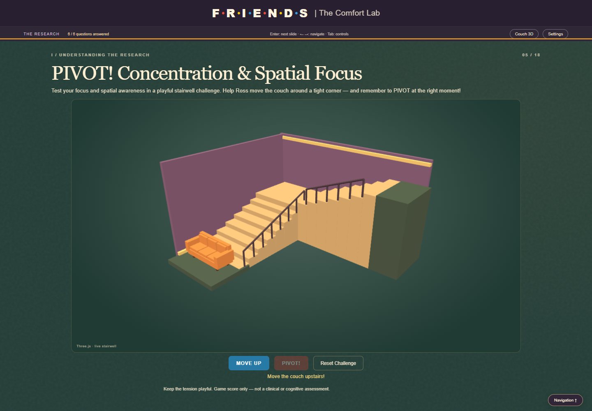

# FriendsAnxietyStudio — Version 0.8

**[Published demo: Friends Comfort Lab](https://liatkaf.github.io/friends-interactive-presentation/)** — verified November 1, 2026: the deployed **v0.7 baseline** loads 18 slides, seven research figures and both Three.js scenes. **Version 0.8 is local, not pushed or deployed.** [Verification record](llm_logs/pages_verification.json).

A research-first university presentation about comfort viewing, six optional profile questions, and an explainable recommendation from **22 real Friends episodes**. Exactly **18 primary slides** preserve the purple door, yellow frame, warm colors and centered **F·R·I·E·N·D·S | The Comfort Lab** branding. No paid services, API keys or remote runtime dependencies are needed.

## Run locally

Requirements: Node.js 18+ (22+ for browser tests), Python 3.8+, a modern browser, and optional WebGL 2. No package installation is needed.

```powershell
node serve.cjs
```

Open **http://127.0.0.1:8000**. Windows uses `py -3`; other systems use `python3`. Set `FRIENDS_PYTHON` to an interpreter executable if needed. For the QA port, set `$env:PORT = '8008'` before starting the server.

## Version 0.8 experience

- **Slide 1:** the original Three.js mug rotates continuously while its slide and document are visible. Drag or use focused-canvas arrow keys; automatic motion eases back after release. One guarded frame loop pauses when hidden. Reduced motion gives a static, manually rotatable mug. The replay button and five-second limit are removed.
- **Slide 3:** four numbered, focusable cards explain predictability, social surrogacy, cognitive ease and nostalgia in a responsive 2×2 grid, replacing the arch.
- **Slide 5:** the stairwell fills 92% of available content width. Compact blue MOVE UP, red PIVOT! and outlined Reset Challenge controls sit below it. Brief feedback replaces the visible score/dashboard. Original couch geometry, lights, stairs, camera framing and actual position/yaw changes remain.
- **Slides 6–8:** Python-generated data drives a grouped/switchable descriptive-means chart and seven original-figure explorers. Bars have pointer/focus tooltips and an accessible table. Figure tabs provide conditions, outcomes, concise takeaways, citations and enlargement.
- **Slide 14:** six directly selectable quote cards include character/theme. Every ID works in actual Python and JavaScript fallback scoring, with native Enter/Space activation and persistent selection.
- **Slide 16:** Friends-inspired labels preserve stored low/medium/high meanings and identifiers, including Clear answer and Skip / continue.
- **Navigation:** the bottom bar overlays content without layout shifts. Hover within the bottom 88 pixels to reveal it; it fades/slides away after 1.3 seconds outside. Focus keeps it open. The persistent Navigation toggle supports touch; Escape closes it. Reduced motion removes transitions.

Enter advances from non-interactive background/slide focus on slides 1–17. It preserves native behavior in buttons, links, forms, choices, canvases, editable content and dialogs; held repeats are ignored. Arrows, Home/End, hashes, indicators and Previous/Next remain. Back to Start returns from slide 18 without clearing answers. Try Again revisits editable questions; settings provide explicit reset. Session storage preserves answers across navigation/reload when allowed. Theme, font, text size, reduced motion and optional free-rotation couch remain in compact dialogs.

## The 18-slide story

| Slide | Headline |
|---|---|
| 1 | Welcome to the Friends Comfort Lab |
| 2 | Why Do We Rewatch Friends? |
| 3 | The Psychology of Comfort TV |
| 4 | Predictability & Control |
| 5 | PIVOT! Concentration & Spatial Focus |
| 6 | What the Research Shows |
| 7 | Belonging, Mood & Rejection |
| 8 | Familiar Worlds & Self-Control |
| 9 | Nostalgia & Cognitive Ease |
| 10 | From Research to Recommendation |
| 11 | How Are You Feeling? |
| 12 | What's Your Stress Level? |
| 13 | Who's Your Favorite Friend? |
| 14 | Which Quote Speaks to You? |
| 15 | What Kind of Comfort Do You Need? |
| 16 | How Familiar Is Friends to You? |
| 17 | Finding Your Perfect Match |
| 18 | The One With Your Perfect Episode |

## Architecture and actual Python execution

| Environment | Research | Recommendation |
|---|---|---|
| Included local server | Python-generated bundle; browser rendering | Actual persistent Python 3 worker via `/api/recommend` |
| GitHub Pages/static server | Same generated data; JavaScript interactions | Explicitly labeled JavaScript fallback; no live Python |
| Python unavailable/request fails | Same generated data | Identical deterministic JavaScript fallback |
| Direct `file:` access | Offline bundle/original PNGs | JavaScript fallback; illustrated coffee/stairwell |

`script.js` composes/navigates slides; `v06.js` manages profiles, evidence and real computation states; `lab-core.js` supplies fallback scoring. `v07.js`/`pivot-state.js` isolate gameplay. `v08.js` adds research chart/navigation interactions. `mug.js`/`couch.js` use bundled Three.js r170. The loopback Node server invokes `python/episode_recommender.py --worker`, with request timeouts and no server-side profile storage. Slide 17 distinguishes pending requests, actual Python completion and fallback completion. **Displaying Python-generated JSON is not live Python execution.** The retained illustrative simulator endpoint also executes Python locally, but is not placed in the research narrative.

### Reproduce the research pipeline

```powershell
py -3 python/research_analytics.py
py -3 python/build_catalog.py
```

Use `python3` elsewhere. `data/research_source.json` documents exact published means, scales, citations and figure explanations. `research_analytics.py` loads/validates four unique activities, finite 1–7 ratings, seven PNG signatures and figure identities; transforms means into display widths (`mean / 7 × 100`); exports `data/research_analytics.json` with source/figure SHA-256 hashes. It never estimates bar heights. `build_catalog.py` regenerates the catalog and compatibility-named `data/v05-data.js` offline bundle, including research, quotes and profile labels. Charts consume this Python output. No additional analytics module or chart dependency is needed.

## Research and data provenance

- Derrick, J. L., Gabriel, S., & Hugenberg, K. (2009). Social surrogacy: How favored television programs provide the experience of belonging. *Journal of Experimental Social Psychology, 45*, 352–362. [DOI](https://doi.org/10.1016/j.jesp.2008.12.003). [Author-lab paper](https://ubwp.buffalo.edu/gabriellab/wp-content/uploads/sites/65/2025/04/Derrick-J.-L.-Gabriel-S.-Hugenberg-K.-J.-2009.-Social-surrogacy-How-favored-television-programs-provide-the-experience-of-belonging.pdf).
- Derrick, J. L. (2013; online 2012). Energized by Television: Familiar Fictional Worlds Restore Self-Control. *Social Psychological and Personality Science, 4*(3), 299–307. [DOI](https://doi.org/10.1177/1948550612454889).

Paper A, Study 1, Table 1, p. 355 supplies these descriptive means:

| Activity | Doing when lonely | Feeling lonely |
|---|---:|---:|
| Favorite TV program | 5.81 | 2.64 |
| Whatever is on television | 4.86 | 3.69 |
| Favorite music | 5.82 | 2.97 |
| Favorite movie | 5.00 | 3.43 |

Responses use 1–7 scales. Loneliness is reverse-scored: lower means less likely to feel lonely. The display axis starts at zero; the response scale remains 1–7. These undergraduate descriptive ratings are **not clinical anxiety scores or causal estimates**.

Slide 7 retains all four Paper A originals: belongingness essay time, self-esteem, negative mood and rejection. Slide 8 retains all three Paper B originals: RAT puzzle performance, negative mood and daily mood. All seven PNGs remain unchanged in `assets/research/`. Numerical series are unavailable in the documented dataset, so originals are shown without invented numbers. Captions distinguish significant interactions, the marginal rejection interaction (p = .09), non-significant comparisons and observational diary associations. Non-significance does not establish equivalence.

These studies did not specifically test Friends viewers or establish clinical anxiety treatment, cortisol reduction or cognitive energy in physical units. Predictability, cognitive ease and nostalgia are broader educational interpretations; Friends examples and comfort tags are editorial. The retained synthetic simulator is labeled **Educational illustration only — not a validated psychological or medical model**.

## Explainable episode matching

The existing 22-episode catalog retains verified titles, episode numbers, spoiler-light descriptions, moments and TV Guide season sources. v0.8 adds no episodes. Comedy/warmth/nostalgia ratings and comfort tags are subjective editorial classifications.

| Factor | Maximum | Rule |
|---|---:|---|
| Mood | 18 | Exact editorial mood-tag match |
| Self-reported stress | 10 | `(stress/10 × warmth + (1−stress/10) × comedy) / 5` |
| Character | 18 | Featured-character match |
| Quote | 18 | Exact catalog association, or half credit for documented character association |
| Nostalgia | 10 | `1 − abs(episode nostalgia − target) / 4`; targets 1, 3, 5 |
| Familiarity | 8 | New: standalone flag; some: 0.75; rewatcher: nostalgia / 5 |
| Desired experience | 10 | Comedy / 5, warmth / 5 or nostalgia / 5 as appropriate |
| Predictability | 8 | Legacy API compatibility only: exact editorial story-tag match |

Only answered factors enter the denominator. Match = 100 × earned/available points, labeled **algorithmic, not scientific**. Factors round to four decimals; percentages to two. Ties use season then episode. Empty profiles return valid episodes at 0%. Why This Episode? shows actual points, maxima, reasons and sources; two alternatives remain. Surprise Me selects another real episode and labels its JavaScript random-discovery mode.

`data/quotes.json` defines six shared IDs and associations. PIVOT! → Ross, How you doin'? → Joey, and Smelly Cat → Phoebe retain exact catalog associations. We were on a break! → Ross, Could I BE any more...? → Chandler, and I know! → Monica receive **9 of 18 points when their character is featured**. These recurring catchphrases/template are transparently editorial character matches; no exact scene in an unrelated episode is claimed. Every quote has a positive scoring path; a unique recommendation per quote is not guaranteed.

`data/profile_labels.json` retains familiarity IDs `new`, `some`, `rewatcher`, displaying **Who's Chandler?**, **I watch it when it's on TV**, **I know it by heart — 7! 7! 7!**. Nostalgia IDs `low`, `medium`, `high` display **Light Comfort**, **Central Perk Vibes**, **Unagi — Total Awareness & Nostalgia**. Existing saved answers remain valid.

The PIVOT score stays separate from profiles/Python requests. Its hidden state starts at 100, is bounded 0–100, loses 25 for a blocked corner move and earns 10 once for a correct pivot. Bottom → first flight → corner → top remains deterministic. Reset restores poses, warnings and controls. Actual couch position/90-degree yaw track state; WebGL loss switches to synchronized CSS gameplay. Slide 5 uses **tension**, with **Game score only — not a clinical or cognitive assessment**. The authored route is not a physics solver.

## Tests and screenshots

With the server running:

```powershell
py -3 tests/test_v05.py
py -3 tests/test_v08.py
node tests/pivot-state-test.cjs
$env:TEST_BASE = 'http://127.0.0.1:8008'
node tests/browser-test.cjs
node tests/stairwell-context-test.cjs
node tests/chart-layout-test.cjs
node tests/capture-v08.cjs
powershell -NoProfile -File tests/make-contact-sheets.ps1 -Version v08
```

Executed November 1, 2026: **455 browser assertions, 14 Python tests, 33 game-rule checks and 14 real WebGL context-loss checks passed**. Final screenshot run: **11 checks passed**, including touch mug drag/release. Final chart-axis alignment/proportion regression: **18 checks passed** across five widths. No unexpected JavaScript errors or external requests occurred. Three expected renderer errors came only from deliberately disabling WebGL. Both generation commands, JavaScript syntax checks and `git diff --check` passed; original assets/vendor/catalog remain unchanged.

Use the actual server port. Browser tests launch isolated headless Microsoft Edge through DevTools; set `BROWSER_PATH` for another Chromium executable. Software WebGL needs compilation/paint time; tests observe actual frames and score parity. Results are recorded in [v0.8 review notes](screenshots/v08/visual-review.md) and [browser results](screenshots/v08/v08-results.json).

Contact sheets: [desktop 1–6](screenshots/v08/v08-contact-desktop-1.png), [7–12](screenshots/v08/v08-contact-desktop-2.png), [13–18](screenshots/v08/v08-contact-desktop-3.png); [mobile 1–6](screenshots/v08/v08-contact-mobile-1.png), [7–12](screenshots/v08/v08-contact-mobile-2.png), [13–18](screenshots/v08/v08-contact-mobile-3.png).



## Deployment, attribution and history

GitHub Pages can publish the root HTML/CSS/JS plus `assets/`, `data/` and `vendor/` with relative paths intact. Static hosting cannot run the Python worker. Regenerate/validate data locally; select the repository branch/root in GitHub Settings → Pages. A separate push/deployment publishes changes; **no push is performed for this upgrade**.

`assets/central-perk-original.png` and `assets/friends-couch-original.png` are user-created artwork, retained unchanged but absent from the UI from v0.6 onward. Research figures belong to their authors/publishers. Three.js r170 is bundled under MIT; see `vendor/THREE-LICENSE.txt`. No episodes or theme music are embedded. This is an unofficial educational project.

- Initial deck: `738469b`.
- v0.4 psychology deck: `feaf0e6`.
- v0.5 research explorer/real Python recommender: `5c0f685`.
- v0.6 research-first 18-slide redesign: `b6603ae`; [retained evidence](screenshots/v06/visual-review.md).
- v0.7 brand, stairwell rules, Enter and Back to Start: `2864113`; [retained evidence](screenshots/v07/visual-review.md). Its deployment was verified during v0.8 work.
- v0.8: continuous mug, focused visual layouts, validated research pipeline, six quote mappings, new profile labels and optional navigation.

Previous documentation is preserved as historical release material in [v0.7 README](docs/v07-README.md) and [v0.7 PRD](docs/v07-PRD.md); its historical behavior/test counts do not describe v0.8.

OpenAI Codex assisted with implementation, test authoring, source verification, visual review and documentation. No live LLM is needed. [v0.8 prompt summary and decisions](llm_logs/llm_prompts_log.md) records this work without inventing earlier conversations.

Known limitations: curated catalog and subjective comfort ratings; no clinical validity or comfort guarantee. Original figures need enlargement for fine text. Small screens and large fonts can scroll vertically. Actual Python needs a local interpreter; static hosts use the explicit fallback. Reload retries 3D after WebGL context loss. Formal user testing, screen-reader certification and physical-device testing across browsers have not been performed. Restricted session storage may limit reload persistence.
