# Friends Comfort Lab — v1.0 FINAL

[Explore the live presentation](https://liatkaf.github.io/friends-interactive-presentation/) · [GitHub repository](https://github.com/liatkaf/friends-interactive-presentation) · [PRD](PRD.md)

## Project Overview

Why can a familiar fictional world feel comforting? Friends Comfort Lab explores that question through a **17-slide interactive research story**, then invites visitors to build an optional comfort profile and discover an explainable match from **22 real Friends episodes**.

The project connects careful reading of two research papers with original visual storytelling: a real 3D coffee mug, a stairwell game, Python-authored research animations, a painted character gallery and transparent episode scoring. The student chose the topic and directed successive creative and technical decisions; AI assisted implementation and artwork under that direction.

**An educational experience and entertainment recommender, not a clinical assessment.** Published findings, broader interpretation, fictional examples and editorial recommendations are labelled separately. The papers did not test Friends as a treatment. No episode footage, theme music, live AI service or API key is used.

v1.0 FINAL is already [published and verified](docs/FINAL_PUBLICATION.md). This walkthrough documents that version. [Screenshot inventory and review](docs/README_GUIDED_TOUR_REVIEW.md) records provenance, numbering, clipping and duplicate checks.

[Highlights](#highlights) · [All 17 slides](#a-guided-tour-of-all-17-slides) · [Interactions](#interactive-features-in-action) · [Technology](#technologies-and-development-process) · [Research and documentation](#research-and-academic-documentation)

## Highlights

### A familiar punchline becomes a learning moment

Predict Joey's reaction, then discover why anticipation can be part of the enjoyment. The illustrated payoff below follows a real visitor choice; Slide 4 in the tour shows the starting state.

<a href="screenshots/readme-tour/joey-payoff.webp"></a>

### A playable scene, built in real 3D

The orange couch reaches the landing after the correct move–pivot sequence. This is the completed PIVOT game, distinct from the starting stairwell on Slide 5.

<a href="screenshots/readme-tour/pivot-success.webp"></a>

### Character art that responds to a choice

Selecting Joey enlarges his painted card and reveals his description. Slide 12 below shows the same gallery with Monica selected, making the change visible without repeating an image.

<a href="screenshots/readme-tour/portrait-selected.webp"></a>

## A Guided Tour of All 17 Slides

Follow the presentation in its actual order. Every primary image below was captured directly from the **published site** at 1440 × 1000, with its live title, slide ID and content dimensions checked. Each image appears once in this README; click it for full resolution.

The profile screenshots use deliberately selected example answers: Happy, stress 5, Monica, “I know!”, Warmth, rewatcher and high nostalgia. They are not defaults. The later interaction examples identify their changed states.

### Slide 01 — Welcome to the Friends Comfort Lab

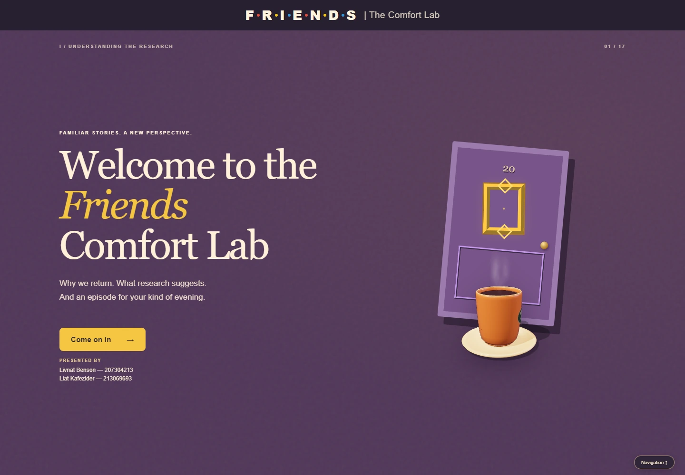

**Purpose:** Welcome visitors into a familiar fictional world and introduce the question behind the project: why can rewatching feel comforting?

**What makes it special:** Drag the coffee mug or use its keyboard controls to change the view. Its gentle rotation stops when the slide is hidden, keeping the welcome scene alive without distracting from later slides.

**Behind the scenes:** Bundled Three.js renders real geometry; JavaScript manages input and visibility, within an HTML/CSS apartment-door composition.

### Slide 02 — Why Do We Rewatch Friends?

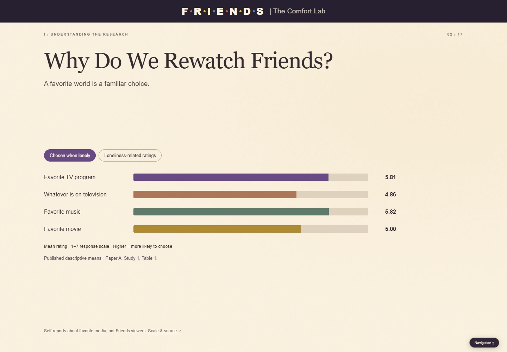

**Purpose:** Begin with a research question rather than treating the appeal of Friends as established scientific fact.

**What makes it special:** Switch between choosing an activity when lonely and loneliness-related ratings. Bars and contextual text change together, helping the audience see that these are different self-reported measures. The source dialog explains the scales.

**Behind the scenes:** Python prepares the published descriptive data; JavaScript draws the HTML/CSS chart. The study concerned favorite media, not a Friends treatment.

### Slide 03 — The Psychology of Comfort TV

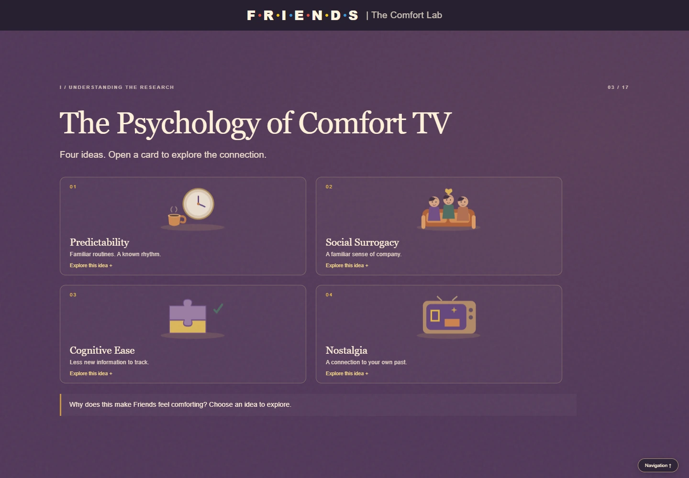

**Purpose:** Give the audience four useful ideas for interpreting comfort viewing: predictability, social surrogacy, cognitive ease and nostalgia.

**What makes it special:** Open an illustrated card to reveal its explanation and example. Only one stays open, and the takeaway changes with the selected concept, turning a list of terms into a small exploration.

**Behind the scenes:** Original SVG illustrations, semantic HTML buttons, CSS transitions and JavaScript disclosure state support mouse and keyboard interaction.

### Slide 04 — The One With the Missing Punchline


**Purpose:** Make predictability tangible: knowing a familiar reaction does not necessarily remove the pleasure of watching it unfold.

**What makes it special:** Play the restaurant setup, wait for the freeze, choose a prediction, then reveal Joey's reaction and the educational takeaway. Replay starts the sequence again; predictions receive no score.

**Behind the scenes:** AI-assisted painted artwork supplies two poses; JavaScript sequences the reveal. This is a labelled fictional adaptation, not episode footage or a scientific experiment.

### Slide 05 — PIVOT! Concentration & Spatial Focus

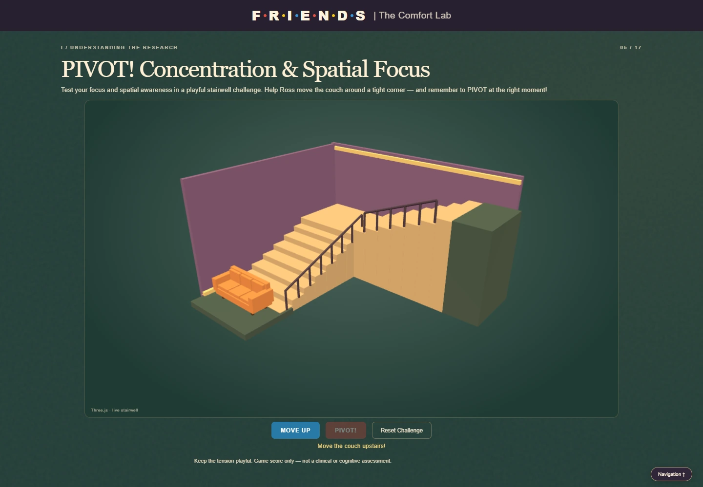

**Purpose:** Offer a playful focus and spatial-awareness break before the detailed research, without presenting game performance as a psychological test.

**What makes it special:** Move the orange couch upstairs, pivot at the tight corner and reach the landing. Trying to move through the corner first produces a blocked-move response; Reset Challenge restores the starting state.

**Behind the scenes:** Three.js renders the stairwell and moving couch. A separate JavaScript state machine enforces the rules without affecting episode recommendations.

### Slide 06 — What the Research Shows

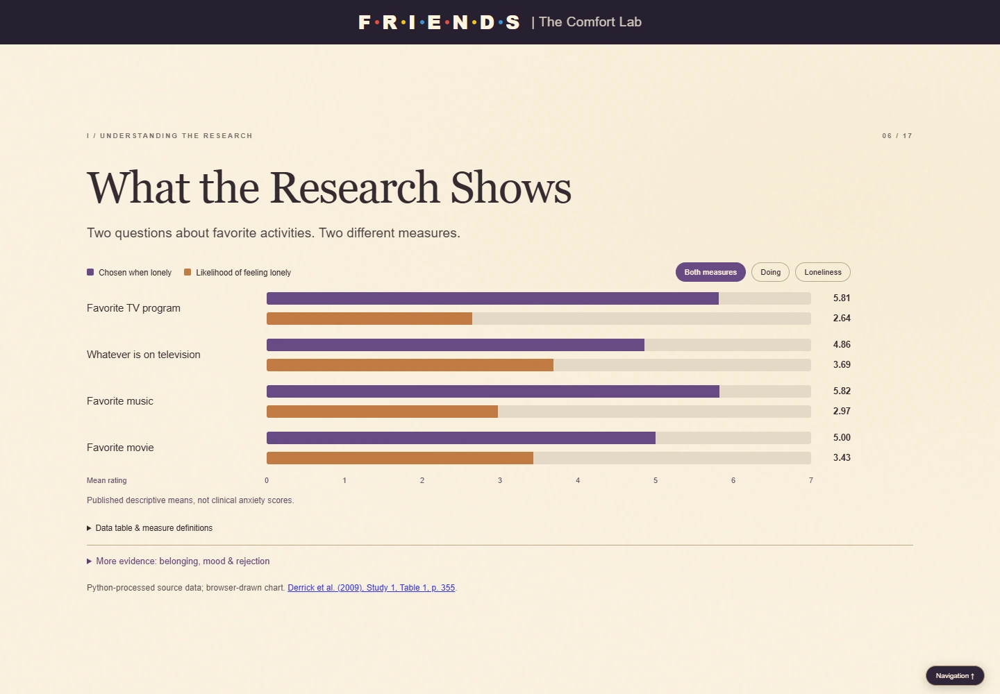

**Purpose:** Slow down and examine the evidence introduced on Slide 2, distinguishing activity choice from loneliness-related ratings.

**What makes it special:** Toggle the chart series, inspect a bar's value, or open the data table. A separate disclosure offers belongingness findings, original figures and additional research animations, keeping the main comparison readable.

**Behind the scenes:** Python validates and exports source data; JavaScript builds the chart and evidence controls. Reported significance categories are not invented effect sizes or clinical anxiety scores.

### Slide 07 — The Self-Control Recovery Lab

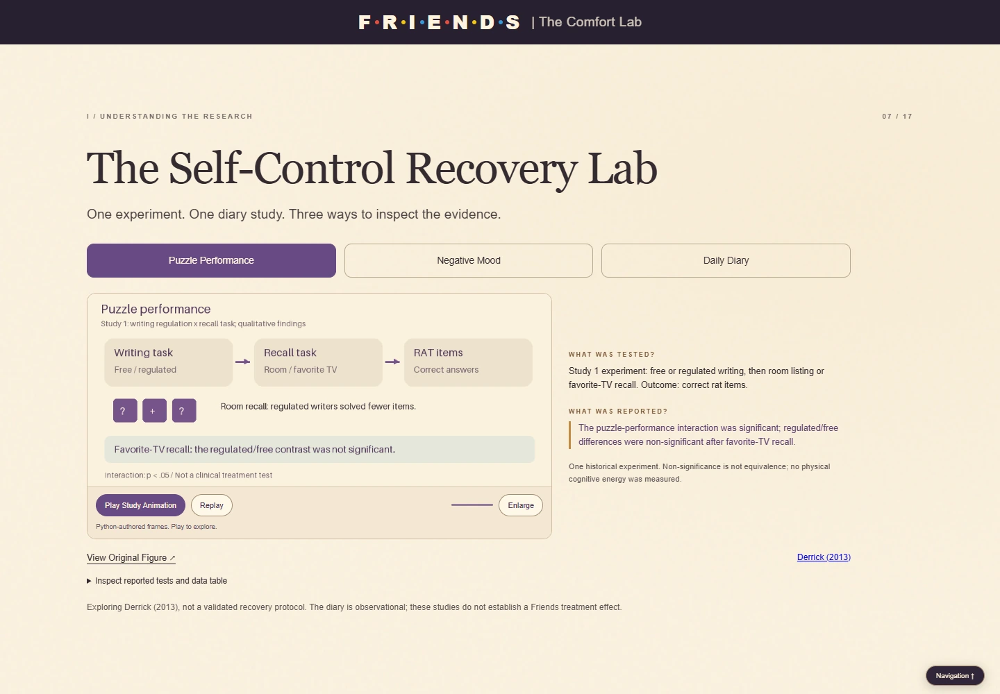

**Purpose:** Explain what the self-control research actually tested, separating an experiment from an observational diary study.

**What makes it special:** Choose Puzzle Performance, Negative Mood or Daily Diary, then play, pause, replay or enlarge its animated explanation. Study design, reported finding and limitations remain alongside the picture.

**Behind the scenes:** Python and Pillow render complete bitmap frames offline. JavaScript plays those exported assets; it does not invent measurements, and reduced-motion visitors retain static summaries.

### Slide 08 — The One With The Rewind


**Purpose:** Translate the broader ideas of nostalgia and cognitive ease into a recognizable action before introducing the personal profile.

**What makes it special:** Press REWIND: the cassette and television animate, a familiar room appears, and two short explanations are revealed. Replay repeats the transition; reduced motion shows the completed state directly.

**Behind the scenes:** HTML/CSS shapes, original SVG room artwork and JavaScript timers create the effect. These concepts are educational interpretation, not direct outcomes of the featured experiments.

### Slide 09 — Finding Your Episode Lobster!

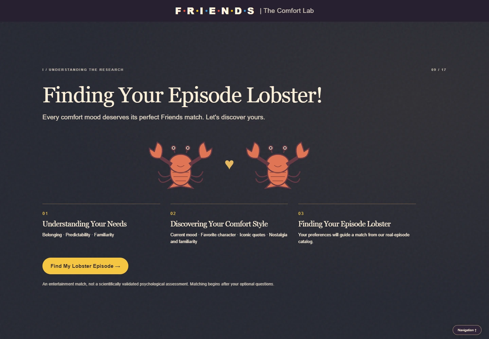

**Purpose:** Bridge the research narrative and the optional questionnaire, explaining what the audience will do next.

**What makes it special:** Two illustrated lobsters meet while three stages appear: understanding needs, discovering a comfort style and finding an episode. The button advances to the first question; it does not claim that a match already exists.

**Behind the scenes:** Original SVG lobsters, CSS movement and JavaScript timing provide a themed transition. The eventual recommendation is entertainment, not a validated assessment.

### Slide 10 — How Are You Feeling?


**Purpose:** Invite a lightweight reflection on the visitor's current mood as the first optional preference.

**What makes it special:** Choose one of six illustrated mood cards. Hover and focus animate the symbols gently; selection changes the accent and saved-answer feedback. Clear the answer or continue without choosing, and ordinary navigation preserves the choice.

**Behind the scenes:** Original SVG symbols and CSS styling project the single JavaScript profile store. The labels are recommendation inputs, not diagnostic categories.

### Slide 11 — What's Your Stress Level?

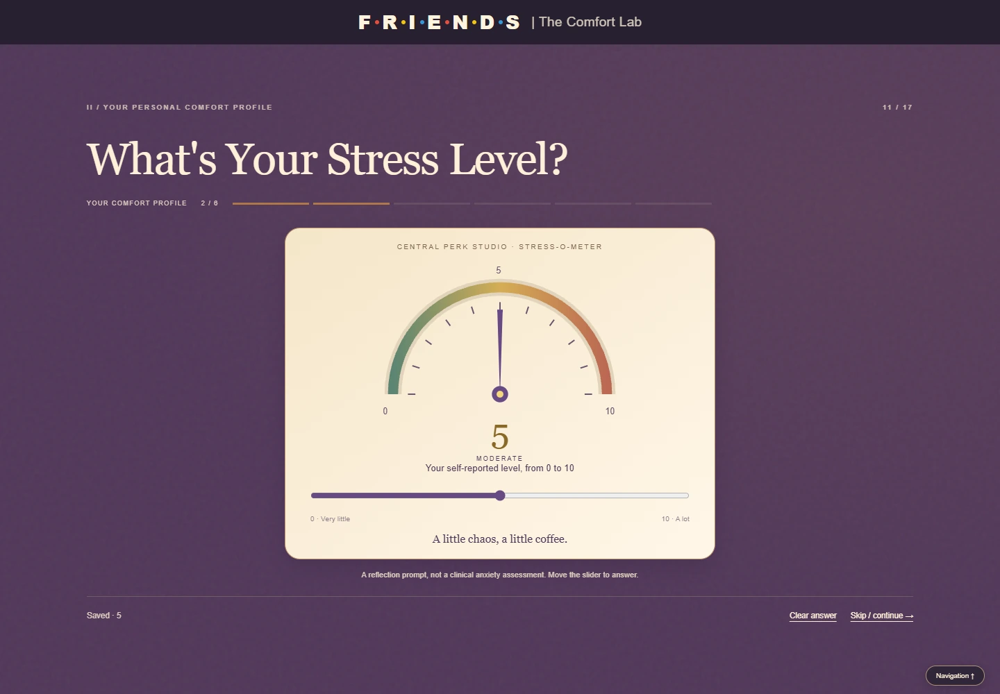

**Purpose:** Let visitors describe their current stress level while making the entertainment-only boundary explicit.

**What makes it special:** Move the native 0–10 slider: the retro gauge needle, numeric reading, band and playful caption respond together. The initial midpoint is only a preview and does not count as an answer; clearing restores the unanswered state.

**Behind the scenes:** JavaScript maps the stored value to an SVG needle, with CSS easing and an accessible HTML range input. This is not a clinical scale.

### Slide 12 — Who's Your Favorite Friend?

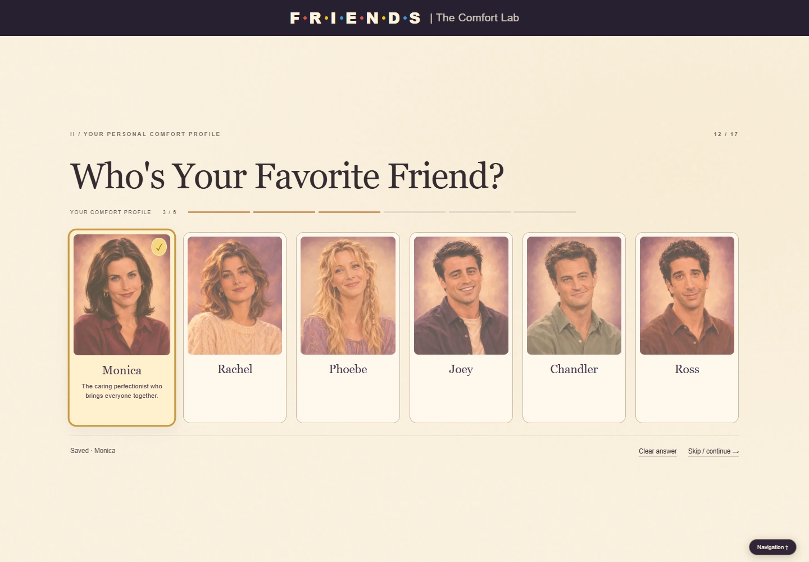

**Purpose:** Bring a favorite character into the recommendation and give the profile a more personal visual identity.

**What makes it special:** Choose among six painted portraits. The selected card grows slightly, gains a highlighted border and reveals a personality description; all six choices remain visible.

**Behind the scenes:** AI-assisted artwork is bundled as optimized WebP, with CSS transitions and JavaScript selection state. Python only resized and encoded the images. Rachel is an original interpretation, not a promised actor likeness.

### Slide 13 — Which Quote Speaks to You?

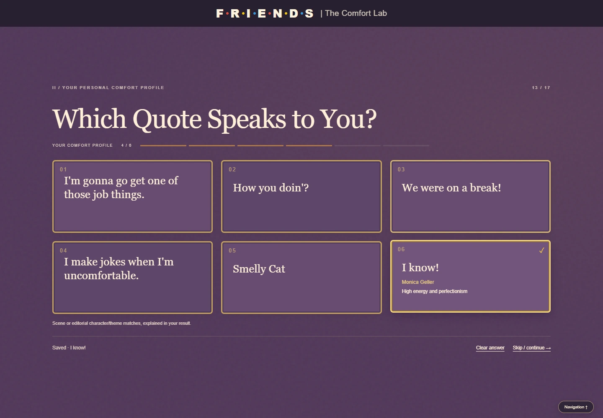

**Purpose:** Connect Rachel's search for independence and Chandler's humor in uncomfortable moments with the broader theme of emotional comfort.

**What makes it special:** Choose among six framed quotes, one per character. Selection lifts the frame and reveals its character and theme; Clear Answer removes it without changing other preferences.

**Behind the scenes:** HTML/CSS and JavaScript retain the interaction. Rachel's independence and Chandler's humor-as-coping lines use explicit editorial episode affinities, labelled as thematic matches rather than verified quote scenes.

### Slide 14 — What Kind of Comfort Do You Need?


**Purpose:** Ask what kind of viewing experience would suit this evening: laughter, warmth, friendship, nostalgia or something light.

**What makes it special:** Pick an illustrated Central Perk-inspired menu item. A YOUR ORDER stamp and immediate text feedback confirm the choice, making preference entry feel like ordering comfort without adding a checkout step.

**Behind the scenes:** Original SVG menu illustrations, CSS selection effects and JavaScript update the existing experience field. Episode ratings behind the match are editorial, not measured therapeutic properties.

### Slide 15 — How Familiar Is Friends to You?


**Purpose:** Separate knowledge of the series from the amount of nostalgia a visitor wants, so newcomers can participate too.

**What makes it special:** Press a familiarity button on the illustrated remote, then choose nostalgia independently. The remote display and nostalgia bars update; each field can be cleared separately. Completing both shows a cue without automatically navigating away.

**Behind the scenes:** Semantic HTML fieldsets, CSS artwork and JavaScript render two existing profile values. Both answers remain optional.

### Slide 16 — Finding Your Perfect Match

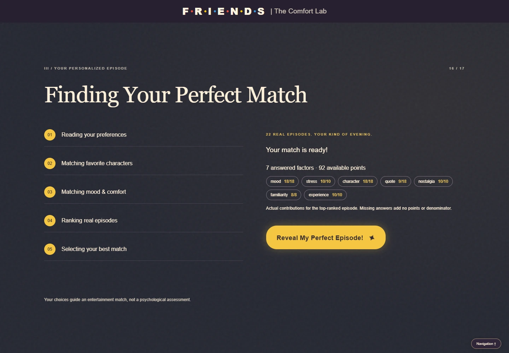

**Purpose:** Make the recommendation process understandable before revealing the chosen episode.

**What makes it special:** The five-step display stays incomplete while a result is pending. Once ranking finishes, it shows contributing factors and enables the reveal button. Unanswered questions are omitted rather than silently assigned values.

**Behind the scenes:** Deterministic scoring ranks 22 catalog episodes. GitHub Pages uses the JavaScript engine; the local Node server can execute the equivalent Python worker. No live AI model chooses the result.

### Slide 17 — The One With Your Perfect Episode


**Purpose:** Turn the profile into a transparent entertainment suggestion rather than an unexplained final score.

**What makes it special:** Read the top episode and two alternatives, open Why This Episode? for factor contributions, or request a different discovery with Surprise Me. Try Again clears the whole attempt and returns to Slide 10; Back to Start preserves answers.

**Behind the scenes:** JavaScript renders catalog metadata and ranking explanations. Match percentages describe an editorial algorithm, not scientific probabilities or predicted health benefits.

## Interactive Features in Action

The following are different captured states, not extra slides. Compare them with their starting states in the tour; the three Highlights above also show outcomes. No screenshot is embedded twice.

### Slide 3 — From concept card to explanation

Opening Predictability reveals its example and changes the takeaway below the cards. Choosing another idea closes the previous explanation, so the visitor explores one connection at a time.

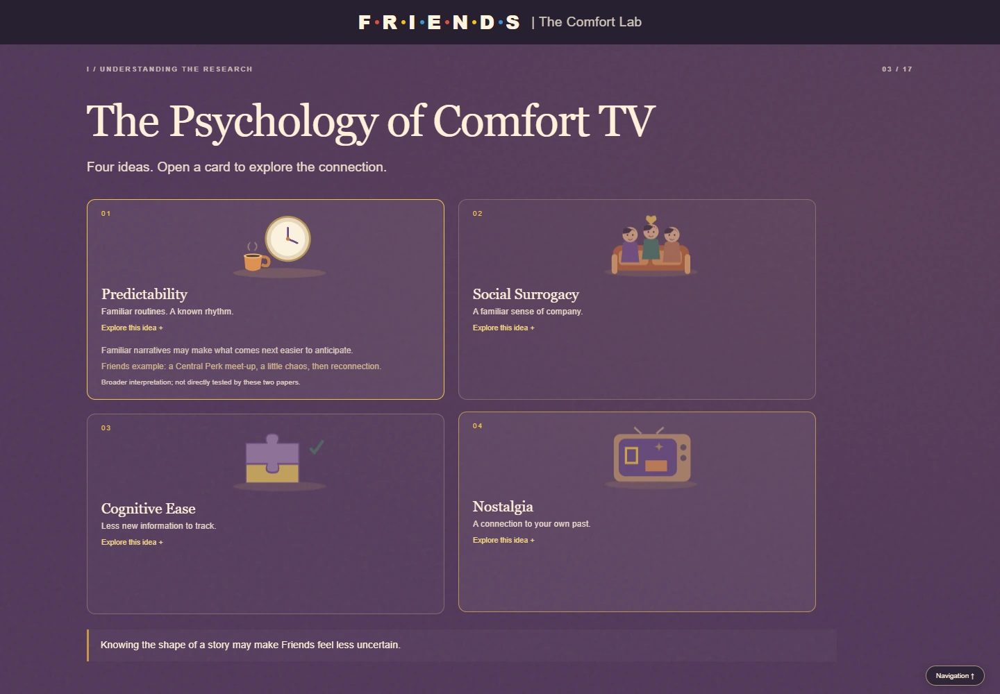

### Slide 4 — The pause before the punchline

The scene freezes and waits for a prediction. There is no countdown, score or correct-answer badge. Choosing a response leads to the reaction and educational explanation shown in Highlights; Replay clears that reveal.

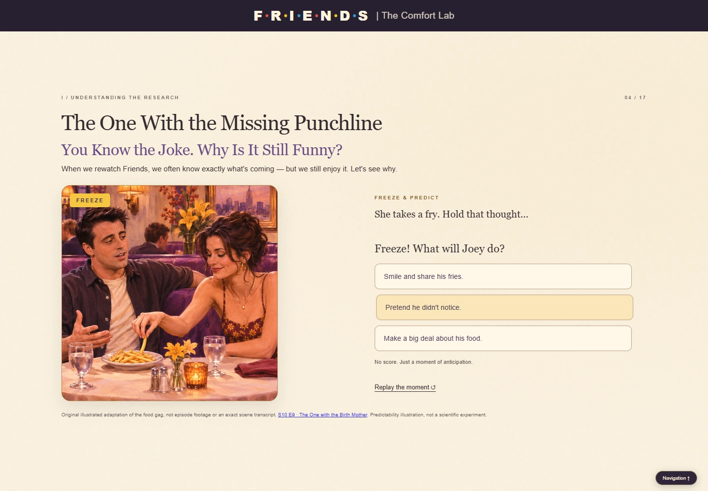

### Slide 7 — An animation you can pause and inspect

This is a paused frame from the Python-rendered puzzle sequence, rather than the final static poster shown in the tour. Play/Pause and Replay control the exported sequence; Enlarge opens a larger viewer. Adjacent text retains the experiment's design and limits.

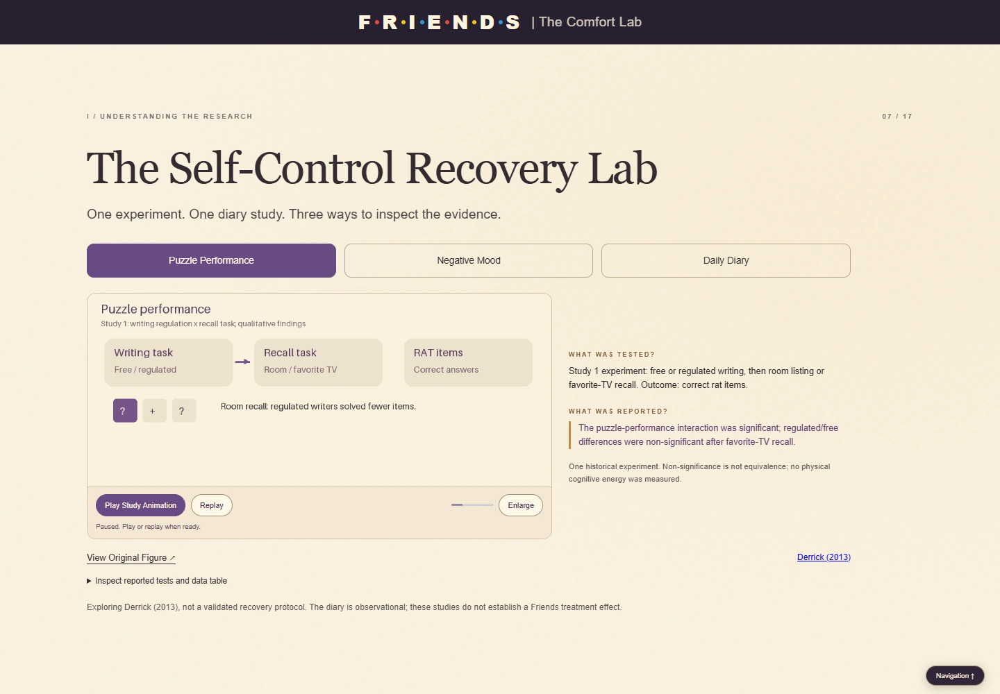

### Slide 8 — Rewind reveals the familiar room

The television starts dark in the tour. Pressing REWIND animates the transition, reveals the room and displays explanations of Nostalgia and Cognitive Ease. These are interpretive ideas, not newly measured research outcomes.

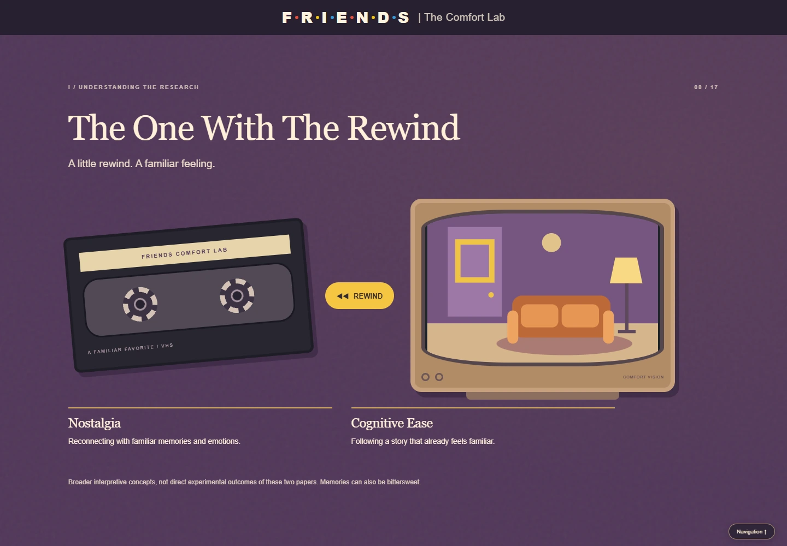

### Slide 17 — Open the recommendation's reasoning

Why This Episode? opens the actual scoring breakdown. Here stress, character and desired experience were deliberately changed to 8, Joey and Friendship before recomputing. The dialog explains contributing factors; its percentage is an algorithmic match, not a probability of feeling better. Try Again clears the profile and returns to Slide 10.

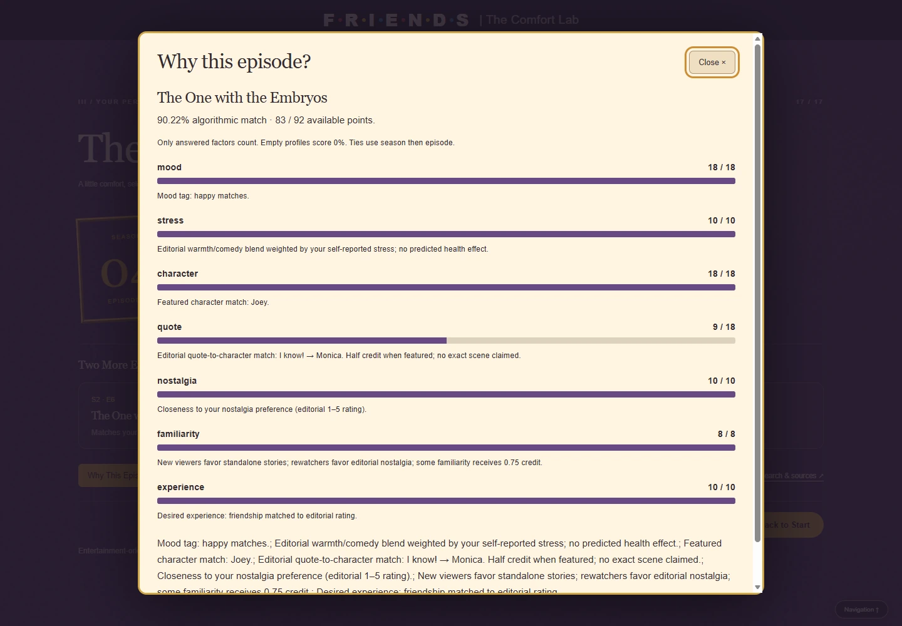

## Technologies and Development Process

### Creative direction and project evolution

Friends provides a recognizable cultural example through which to explain belonging, familiarity and comfort viewing. The user selected the topic and directed successive changes to the narrative, branding, research presentation, 3D game, questionnaire and reset behavior. These choices, rather than an invented personal biography, demonstrate personal involvement. Original code illustrations translate the user's coffee-shop, VHS, lobster and recognizable sitcom concepts into a coherent purple, yellow, cream and orange visual identity.

The featured papers did **not** test Friends as a clinical treatment. The presentation separates published evidence, broader psychological interpretations, fictional examples, editorial matching scores and educational simulations. It contains no episode footage or theme music.

### Architecture: what actually runs

| Layer | Responsibility |
|---|---|
| HTML/CSS | Accessible presentation shell, visual identity, responsive cards, original scene composition |
| `script.js`, `v06.js` | Slide templates/navigation, existing single profile state, recommendations and research dialogs |
| `v10-art.js`, `v10.js`, `v10.css` | Original SVG cards, finite Python-frame playback and lab UI |
| `v08.js`, `v09.js` | Research chart, qualitative evidence access, navigation dock, rewind and lobster interactions |
| `joey.js`, `joey.css`, `assets/joey/restaurant-storyboard.png` | Original generated restaurant artwork, progressive setup/prediction/reaction, unscored payoff and replay |
| `mug.js`, `couch.js`, bundled Three.js r170 | Genuine 3D coffee and stairwell; no remote CDN dependency |
| `python/research_analytics.py` | Validate documented means and seven figure records; export research JSON |
| `python/generate_animations.py` | Render every animation pixel with Pillow; export posters, sprite atlases and GIF previews |
| `python/episode_recommender.py` | Actual persistent local Python worker, deterministic scoring through `/api/recommend` |
| `lab-core.js` | Equivalent JavaScript scoring fallback for static hosting or Python failure |

On GitHub Pages there is **no live Python runtime**. Python-generated data/assets still work, with JavaScript controlling frame playback and fallback matching. Locally the included server actually executes Python for matching. Engine diagnostics stay in the console and `FriendsLab.diagnostics`, outside ordinary user status text. No user profile is stored server-side or sent to an external AI service.

#### Reproduce the Python animation pipeline

**Verified evidence - validated JSON - Python/Pillow frames - exported assets - JavaScript playback.**

```powershell
py -3 -m venv .venv
.venv/Scripts/python.exe -m pip install -r python/requirements-animation.txt
.venv/Scripts/python.exe python/research_analytics.py
.venv/Scripts/python.exe python/build_catalog.py
.venv/Scripts/python.exe python/generate_animations.py
```

On macOS/Linux use `python3` and `.venv/bin/python`. Pillow 10.4.0 is pinned; the generator uses its bundled default scalable font. A clean virtual environment avoids the broken system Pillow DLL encountered during this build. Dependency download needs internet, but regeneration and presentation playback do not. pandas/Matplotlib are unnecessary for categorical evidence and original frame artwork; Pillow is the actual authoring library.

Inputs: `data/research_source.json` (citations, verified means, study designs and categorical findings). Outputs: `data/research_analytics.json`, `data/v05-data.js`, `data/python_animations.json`, `data/python_animations.js`, and `assets/generated/`. The animation manifest records source/code/asset SHA-256 hashes. The reproducible archive contains eight sequences, seven of which remain accessible as research animations. The retired social-scene export is retained for historical reproducibility, not displayed. Each has 16 frames, a 960x400 poster, a PNG frame atlas and a finite GIF preview: **24 image assets**, about 3.9 MB total. `--output <directory>` supports isolated generation. JavaScript does not redraw or invent the Python scenes; it displays the exported frames.

Historical `python/generate_data.py` produces explicitly synthetic educational illustrations, not published research measurements and not the data source for Slides 6-8. Do not confuse that retained artifact with the verified pipeline.

### Run the presentation locally

Requirements: Node.js 18+ (22+ for browser QA), Python 3.8+, a modern browser; WebGL 2 is optional with fallbacks. No npm installation or API key is required.

```powershell
node serve.cjs
```

Open http://127.0.0.1:8000. The server prefers the project's `.venv` interpreter; otherwise it invokes `py -3` on Windows or `python3` elsewhere. `FRIENDS_PYTHON` overrides either choice. After migration, Python 3.11.9 and Pillow 10.4.0 are verified on D:. The review session uses http://127.0.0.1:8011.

For a clean static-host preview:

```powershell
python python/static_preview.py --port 8013 --bind 127.0.0.1
```

Open http://127.0.0.1:8013. Serve over HTTP; direct file opening is not the supported way to load Three.js modules.

### How the final narrative took shape

- **Slide 3:** four original SVG concept reveals remain unchanged.
- **Slide 4 - The One With the Missing Punchline:** an original, polished restaurant illustration inspired by Joey's food gag in S10 E9, *The One with the Birth Mother*. Play the setup, freeze before his reaction, choose one of three predictions, then reveal the familiar catchphrase and the explicit educational takeaway. No score or right/wrong feedback. Replay clears the interaction; keyboard and reduced-motion modes preserve all content. Approximately 15-20 seconds at normal reading/choice pace, not a forced timed quiz.
- **Previous Slide 7 removed:** the weak social mini-story was removed with the student's approval. Exactly 17 primary slides remain, with contiguous IDs, counters, hashes and navigation. The four unique Paper A findings, Python animations, original figures and accessible tables now live in the optional **More evidence: belonging, mood & rejection** disclosure on Slide 6, avoiding a second introductory story.
- **Current Slide 7:** the three-module Self-Control Recovery Lab retains genuine Python-authored animations, source access, playback/replay and limitations.

The student reviewed the completed presentation, found the original Slide 4/7 animations visually weak and their stories lacking a meaningful payoff, considered alternatives, selected the recognizable Joey scene, explicitly requested an explanation of its educational purpose and approved removing repetition. This is a [summarized design decision](llm_logs/v1-content-refinement.md), not an invented conversation transcript.

Preserved: continuous genuine Three.js mug with drag and inactive-slide pause; centered branding and idle-hidden navigation; 3D PIVOT stairwell and isolated game scoring; Study 1 chart; VHS rewind (Slide 8); lobster transition (Slide 9); six character and six quote choices; familiarity/nostalgia mapping; deterministic matching and alternatives; theme controls; keyboard navigation; responsive layouts; all seven original research figures.

**Try Again clears the entire profile, persisted attempt, cached results and pending recommendation state, then returns to Slide 10. Back to Start and ordinary navigation preserve answers.** Enter advances only from noninteractive slide/background focus on Slides 1-16; native controls and dialogs keep normal keyboard behavior. The final recommendation is Slide 17. Use the bottom Navigation button on touch devices or Tab to reach the dock.

### The six profile experiences and artwork provenance

The existing questionnaire remains on **Slides 10-15** (indices 9-14). It now uses six different presentation interactions without adding questions or changing recommendation inputs:

| Slide | Interaction | Preserved contract |
|---|---|---|
| 10 | Six original mood symbols respond to hover/focus and selection | Same six mood values and grid |
| 11 | Retro Stress-O-Meter, moving needle, native slider and playful caption | Same 0-10 input; midpoint preview does not count as an answer |
| 12 | Six warm painted portraits; selected card reveals its personality description | Same character values, one selection, persistent on revisit |
| 13 | Gold-framed Quote Wall; selection reveals character/theme | Six characters, one each; final Rachel/Chandler lines and their explicit editorial mappings |
| 14 | Central Perk menu with five illustrated items and immediate order ticket | Same experience values; no checkout step |
| 15 | TV-remote familiarity buttons plus independent nostalgia dial and completion cue | Same three values per field; no automatic navigation |

The existing progress, Skip / Continue, Clear Answer, refresh persistence and full Try Again reset remain. Individual familiarity/nostalgia clear controls use the existing clear handler. `v06.js` still owns the single profile store; `profile-experience.js` only renders its state after `friends:profilechange`. The [final quote update](docs/SLIDE13_QUOTE_UPDATE.md) changes only Rachel's and Chandler's quote inputs and editorial affinities. All 18 still-current pre-upgrade cases retain exact ranking/factor equivalence; two retired quote-only cases remain in the unchanged historical fixture.

**Portrait provenance:** generated with the actual built-in image tool using Slide 4 as the painted-style reference. The Rachel card uses an original fashion-character interpretation after image-tool rejections, so exact actor likeness is not claimed; Phoebe uses an original fictional interpretation. [Exact prompts/outcomes](llm_logs/profile-portrait-prompts.json) and [asset hashes](assets/portraits/provenance.json) document this limitation. The six optimized WebP assets total about **189 KB**. No new dependency: the existing Pillow 10.4.0 is used solely for resizing/encoding, not portrait authorship. The local server includes the WebP MIME type; static hosting needs no Python runtime for these assets.

To re-export from the original generated PNGs (not included as large runtime assets), name them `monica.png` through `ross.png` and run:

```powershell
.venv/Scripts/python.exe python/prepare_portraits.py --input-dir test-results/portrait-sources
```

Original generation is nondeterministic and needs an image-generation capability; the app itself uses only the bundled optimized files. [Current before/after screenshots, executed tests and limitations](screenshots/profile-upgrade/visual-review.md). [Recorded instruction and design rationale](llm_logs/profile-upgrade.md). That earlier upgrade was subsequently included in the published v1.0 FINAL release.


[Changed and added files](docs/PROFILE_UPGRADE_FILES.md). Profile-upgrade milestone QA: 267 dedicated profile checks, 433 presentation checks, 91 retained UX checks, 26 Python tests, 36 layout cases and 34 static-host checks; before/after capture runs each passed 14 checks. See the profile visual review for those results and the Rachel likeness limitation; the subsequent [final quote update](docs/SLIDE13_QUOTE_UPDATE.md) records current quote-specific checks.

### Verification and reproducibility

[Release file manifest](docs/V1_RELEASE_MANIFEST.md) lists created/modified files. [Development journey](DEVELOPMENT_JOURNEY.md) links authentic Git milestones. [Prompt history](llm_logs/README.md) distinguishes recorded summaries from transcripts. Codex assisted implementation, research checks, testing and documentation; the user supplied creative direction and successive corrective specifications. No live LLM or paid service is required by the product.

[Final compliance matrix](FINAL_COMPLIANCE_REPORT.md) separates repository evidence from external Moodle actions. [Adversarial review](RED_TEAM_REVIEW.md) records findings, fixes, retests and the limits of a same-session AI review.

```powershell
.venv/Scripts/python.exe -m unittest discover -s tests -p 'test_*.py' -v
node tests/pivot-state-test.cjs
$env:TEST_BASE='http://127.0.0.1:8000'
node tests/browser-test.cjs
node tests/v10-ux-test.cjs
node tests/joey-refinement-test.cjs
node tests/v10-layout-test.cjs
node tests/chart-layout-test.cjs
node tests/stairwell-context-test.cjs
node tests/capture-v10.cjs
```

[Current test entry points](tests/README.md) identify active versus historical fixtures. Run browser suites sequentially to avoid competing software-WebGL processes. For `tests/v10-static-test.cjs`, set TEST_BASE to the clean static HTTP server. Browser QA uses installed Edge, Node's built-in CDP/WebSocket support and software WebGL; no Playwright dependency. Actual final results and screenshots are recorded in `screenshots/v10-final/visual-review.md` and its JSON reports. Python pixel/hash tests regenerate all exports in a temporary directory and compare bytes. Legacy test files and prior release screenshots remain historical evidence, not automatically claimed current passes.

## Research and Academic Documentation

### Research references and boundaries

1. Derrick, J. L., Gabriel, S., & Hugenberg, K. (2009). Social surrogacy: How favored television programs provide the experience of belonging. *Journal of Experimental Social Psychology, 45*, 352-362. https://doi.org/10.1016/j.jesp.2008.12.003
2. Derrick, J. L. (2013). Energized by Television: Familiar Fictional Worlds Restore Self-Control. *Social Psychological and Personality Science, 4*(3), 299-307. https://doi.org/10.1177/1948550612454889 (first online 2012).

[Research integrity audit](docs/RESEARCH_INTEGRITY_AUDIT.md) identifies sources, design, claims and limits. Study 1 uses published 1-7 descriptive means, not clinical anxiety scores. Other animations summarize verified significant, marginal or nonsignificant tests without estimating group means from scans. Non-significance does not establish equivalence, p-values are not effect magnitudes, diary associations are not causal effects, and no physical cognitive-energy units were measured. The papers do not prove Friends treats anxiety or lowers cortisol. Predictability, cognitive ease and nostalgia examples are broader interpretations. All seven original PNG figures remain unchanged and accessible through View Original Figure.

The two user-created original artworks remain in `assets/` with attribution to the user but are deliberately absent from the UI following the user's design feedback. New illustrations are original code/Python artwork, AI-assisted under user direction, not copied television screenshots. Research figure copyright remains with the respective authors/publishers; scholarly attribution is not a license for unrestricted redistribution.

### Recommendation and data provenance

The catalog contains 22 real episodes. Titles, season/episode numbers and moment associations retain the prior release's documented verification. Mood/warmth/comedy/nostalgia/predictability tags are **editorial**, not measured psychological properties. Six quotes use `data/quotes.json` in both engines. Weights: mood 18, self-reported stress 10, character 18, quote 18, nostalgia 10, familiarity 8, predictability 8, experience 10. Only answered factors contribute to the available denominator; ties resolve by season/episode. The result includes actual contributing factors and two alternatives. Missing answers are allowed; match percentages are algorithmic, not scientific probabilities or prescriptions.

### Accessibility, provenance and verification limits

Native buttons, semantic figures/dialogs, focus indicators, keyboard playback, source tables and text captions complement visuals. System reduced motion or the quiet-motion setting uses static Python posters, avoids forced animation and preserves all explanations. Large text/small viewports may scroll within slides. Fine source scans and in-frame text can be enlarged; adjacent HTML explanations remain available.

The existing GitHub Pages release is published and verified; see the [publication report](docs/FINAL_PUBLICATION.md). No repository permission change, release tag or Moodle submission was performed. The guided-tour documentation revision was separately reviewed and approved for publication without changing the presentation.

No physical-device or formal screen-reader testing, external human research review, clinical validation or new replication study is claimed. The older studies inform the educational narrative with the limits stated above. The optional game score and editorial episode match are independent of scientific assessment. See the compliance report for outstanding external actions.

#### New illustration provenance and episode accuracy

`assets/joey/restaurant-storyboard.png` is newly generated original restaurant artwork, produced with the built-in image-generation tool under student direction; `joey.js` controls its two poses and timing. It is not a Python-generated asset, copied episode footage or a television screenshot. Its full generation prompt and tool mode are recorded in [the refinement log](llm_logs/v1-content-refinement.md).

[Apple TV confirms S10 E9 and the date taking food](https://tv.apple.com/us/episode/the-one-with-the-birth-mother/umc.cmc.5tjhrgg9ujwfuj7q0mff5gt4h). The familiar catchphrase occurs in Joey's conversation with his friends; this classroom interaction combines the food incident and catchphrase as an explicitly labelled illustrated adaptation, not an exact restaurant-scene transcript. It illustrates anticipation without being a scientific experiment.

#### Final refinement QA summary

Executed: 433 browser regression checks, 41 dedicated Joey checks, 91 focused UX checks, 101 layout checks and 23 Python tests, plus game/context/chart/static-host/capture suites. All passed. All 17 slides were reviewed on desktop/mobile, including the new lesson and retained sources. [Actual reports and visual review](screenshots/v10-final/visual-review.md). These counts describe the earlier refinement stage; the subsequent published-release verification is recorded separately. No release tag was created.

### Lecturer and submission documents

- [Product requirements and acceptance criteria](PRD.md)
- [Lecturer compliance matrix and remaining Moodle actions](FINAL_COMPLIANCE_REPORT.md)
- [Research integrity audit](docs/RESEARCH_INTEGRITY_AUDIT.md)
- [Red Team findings and review limits](RED_TEAM_REVIEW.md)
- [Development journey](DEVELOPMENT_JOURNEY.md), [release file manifest](docs/V1_RELEASE_MANIFEST.md) and [profile file manifest](docs/PROFILE_UPGRADE_FILES.md)
- [Authentic prompt history](llm_logs/README.md), [Joey design decisions](llm_logs/v1-content-refinement.md), [profile design log](llm_logs/profile-upgrade.md) and [portrait prompts/outcomes](llm_logs/profile-portrait-prompts.json)
- [Published-release verification](docs/FINAL_PUBLICATION.md), [all-slide visual review](screenshots/v10-final/visual-review.md) and [profile before/after evidence](screenshots/profile-upgrade/visual-review.md)
- [Current guided-tour inventory and QA](docs/README_GUIDED_TOUR_REVIEW.md)

Historical screenshots, prompts and prior version documents remain in the repository as evidence of development. The guided tour uses new captures of the final published presentation. Check the actual Moodle instructions, submit the required links/materials and confirm receipt; repository publication does not perform those university actions.
