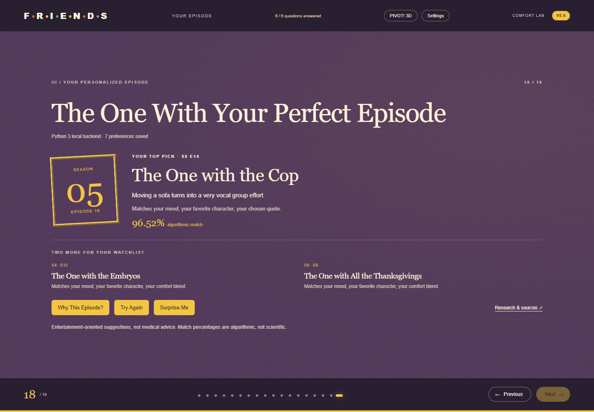

# FriendsAnxietyStudio — Version 0.6

A research-first, Friends-inspired university presentation about comfort viewing. **18 primary slides** move from published evidence, to six optional profile questions, to an explainable real-episode recommendation. Python, JavaScript, local Three.js and restrained animation support the story without turning the deck into a dashboard.

## Start the presentation

Requirements: Node.js 18+ (browser tests need Node.js 22+), Python 3.8+, a modern browser. No packages, paid services, API keys or runtime internet connection are required.

```powershell
node serve.cjs
```

Open http://127.0.0.1:8000. On Windows the server uses `py -3`; elsewhere it uses `python3`. To select an interpreter, set `FRIENDS_PYTHON` to its executable path. To use a different port:

```powershell
$env:PORT = '8006'
node serve.cjs
```

Open http://127.0.0.1:8006. The server listens only on loopback. Ctrl+C stops it. Direct `index.html` access retains navigation, the questionnaire and labeled JavaScript matching; local HTTP serving is needed for Three.js modules and Python.

## The v0.6 redesign

The former 12-slide requirement is **superseded by exactly 18 slides**. The redesign removes interleaved questionnaires and long application-style panels. Each screen has one headline and a main visual, figure or focused question. Supporting methods, full-size figures, scoring and references open only when requested.

The two original white-background PNG artworks are no longer included in the active UI or requested by the browser. Their files remain unchanged in `assets/`. The familiar identity now comes from the purple CSS apartment door, yellow frame, orange couch palette, original vector character portraits, typography and 3D scenes.

| # | Slide | Main element |
|---|---|---|
| 1 | Welcome to the Friends Comfort Lab | Purple door and preserved five-second Three.js mug |
| 2 | Why Do We Rewatch Friends? | Python-generated published-means chart; two metrics |
| 3 | The Psychology of Comfort TV | Four-concept yellow frame |
| 4 | Predictability & Control | Illustrative familiar-story sequence |
| 5 | Parasocial Relationships | CSS orange couch and fictional-company illustration |
| 6 | What the Research Shows | Paper A Figure 1, Study 2 |
| 7 | Belonging, Mood & Rejection | Paper A Figures 2–4, Study 3; selector and enlargement |
| 8 | Familiar Worlds & Self-Control | Paper B Figures 1–3; selector and enlargement |
| 9 | Nostalgia & Cognitive Ease | Then/now visual; interpretations labeled |
| 10 | From Research to Recommendation | Evidence → preferences → editorial matching |
| 11 | How Are You Feeling? | Six mood choices |
| 12 | What's Your Stress Level? | Optional self-reported 0–10 slider |
| 13 | Who's Your Favorite Friend? | Six selectable vector portraits |
| 14 | Which Quote Speaks to You? | Three large quote choices |
| 15 | What Kind of Comfort Do You Need? | Five desired-experience choices |
| 16 | How Familiar Is Friends to You? | Familiarity and nostalgia preferences |
| 17 | Finding Your Perfect Match | Actual request/result states and factor contributions |
| 18 | The One With Your Perfect Episode | Main episode, two alternatives, Why/Try Again/Surprise |

Part I (1–10) presents research before any personal question. Part II (11–16) shows position within the six-question journey, automatic answer saving, selection feedback, clear and skip/continue controls. Part III (17–18) explains the matching and delivers the episode. Nothing is mandatory. An untouched stress slider is unanswered; moving it or confirming its displayed value saves an answer.

PIVOT! 3D is an **optional header activity**, outside the primary slide count. It retains drag, keyboard, slider, angle feedback and reset. Settings opens a compact dialog for palette, font, mood, text size, decorative reduced motion, appearance reset and profile reset. Operating-system reduced motion also controls the mug. Unrelated synthetic activities from v0.4/v0.5 are no longer forced into the narrative; their Python/data sources remain in the repository.

## Architecture and actual Python integration

- `index.html` retains the presentation shell. `script.js` composes 18 sections and handles Previous/Next, indicators, arrows, Home/End, progress and hash deep links.
- `v06.css` lays out the research-first narrative over retained `style.css` primitives. `portraits.js` carries forward the existing vector character art. `mug.js` and `animation-timeline.mjs` remain unchanged; `couch.js` now supports its optional dialog host.
- `v06.js` manages the questionnaire, modal details, research metrics, engine calls and results. `lab-core.js` extracts the existing v0.5 JavaScript scoring rules and verified research-figure metadata without changing the rules.
- `serve.cjs` retains the real persistent Python worker: `python/episode_recommender.py --worker`. It sends newline-delimited JSON on stdin and receives JSON on stdout. `/api/recommend` performs actual Python scoring; `/api/simulate` remains available. Body limits, origin checks and request timeouts remain.
- If Python is absent or fails, the UI explicitly says **JavaScript fallback — Python unavailable**. Python/JavaScript parity is tested. No JavaScript-only result is presented as a newly executed Python computation.
- Existing `v05.js` and `v05.css` remain as historical implementation files; `index.html` no longer loads them. No previous Git commit is rewritten.

Preferences use the same tab-local sessionStorage key as v0.5 so valid existing answers carry over. The redesigned UI maps mood, stress, character, quote, experience, familiarity and nostalgia directly to the existing Python fields. Predictability is no longer a separate question and is omitted from the v0.6 UI profile; the Python API continues to support it for compatibility. There are six questionnaire slides and seven possible answer fields because the final slide explicitly pairs familiarity with nostalgia.

Slide 17 marks preference reading complete after reading local state, leaves computation steps waiting during the request, and marks scoring/ranking complete only after receiving a result or executing the fallback. CSS animates the returned states; it does not simulate Python progress, stream invented backend events, or measure computation duration. Unchanged profiles can reuse an actual cached result. Profile edits invalidate it. The full factor list comes from the returned top recommendation.

## Explainable recommendation rules

The retained database contains **22 real episodes**, verified in v0.5 against TV Guide season listings. Each record includes its source URL, title, season/episode, spoiler-light description, featured characters, associated moments/quotes, editorial comedy/warmth/nostalgia ratings and mood/story/familiarity tags. These ratings are not scientific measurements.

| Factor | Maximum points | Matching rule |
|---|---:|---|
| Mood | 18 | Exact mood-tag match |
| Stress | 10 | With t = stress/10: `(t*warmth + (1-t)*comedy)/5` |
| Character | 18 | Selected name in featured-character list |
| Quote | 18 | Exact catalog association |
| Nostalgia | 10 | Rating closeness to low=1, medium=3, high=5: `1-distance/4` |
| Familiarity | 8 | New: standalone flag; rewatcher: nostalgia/5; some: 0.75 |
| Desired experience | 10 | Comedy/5 for laughter/light entertainment; warmth/5 for warmth/friendship; nostalgia/5 otherwise |
| Predictability (API compatibility only) | 8 | Exact editorial story-tag match |

Only answered factors enter the denominator. Match = 100 × earned/available points; factor points round to four decimals and percentages to two. Empty profiles score 0%; ties use season then episode. Why This Episode? shows actual points, maxima, reasons and episode source. The final slide gives a short summary of the strongest matching factors, with full details on demand.

Try Again returns to slide 11 while preserving editable answers. Settings can clear everything. Surprise Me uses JavaScript randomness to pick a different real catalog episode and the documented formula to score it; this is labeled **JavaScript random discovery**. Normal ranking remains deterministic.

## Research, data provenance and limitations

- Derrick, J. L., Gabriel, S., & Hugenberg, K. (2009). Social surrogacy: How favored television programs provide the experience of belonging. *Journal of Experimental Social Psychology, 45*, 352–362. https://doi.org/10.1016/j.jesp.2008.12.003.
- Derrick, J. L. (2013; first published online 2012). Energized by Television: Familiar Fictional Worlds Restore Self-Control. *Social Psychological and Personality Science, 4*(3), 299–307. https://doi.org/10.1177/1948550612454889.

The seven supplied figure PNGs are unchanged. Slide 6 shows `2009-fig1-belongingness-essay.png`; slide 7 provides self-esteem, negative-mood and rejection figures; slide 8 provides RAT, negative-mood and daily-mood figures. Every figure can be enlarged and accessed through the modal selector, with paper/study/figure identity, axes, conditions, interpretation and DOI citation.

The published chart uses Paper A, Study 1, Table 1, p. 355: favorite TV 5.81/2.64; whatever TV 4.86/3.69; favorite music 5.82/2.97; favorite movie 5.00/3.43. Doing uses a 1–7 scale; loneliness is reverse-scored so lower means less likely to feel lonely. The chart, tooltips, axis explanation and source table use Python-generated values, not estimates from bar heights.

Paper A's self-esteem and mood interactions were significant; its rejection interaction was marginal (p = .09), not significant at .05. The explorer supplies the relevant distinctions. Paper B includes experimental outcomes and observational diary evidence; the diary is not a randomized viewing effect. Non-significance does not establish equivalence. These studies did not specifically test Friends. Predictability, cognitive ease and nostalgia are educational interpretations here. Neither the charts nor editorial matching scores are clinical assessments, anxiety treatments, cortisol findings or scientific probabilities.

Regenerate the retained datasets:

```powershell
py -3 python/research_analytics.py
py -3 python/build_catalog.py
```

The second command also generates `data/v05-data.js`, the offline browser bundle. The name is retained for compatibility. On other systems use `python3`. The original synthetic-data generator remains available as `py -3 python/generate_data.py`.

## Tests, visual review and screenshots

```powershell
py -3 tests/test_v05.py
$env:TEST_BASE = 'http://127.0.0.1:8006'
node tests/browser-test.cjs
```

Use the server's actual URL for `TEST_BASE`, or omit it for port 8000. Browser QA launches isolated headless Microsoft Edge through DevTools; `BROWSER_PATH` can select another installed Chromium executable. The retained Python test filename reflects its origin and still tests the unchanged engine, catalog and research values.

The updated browser suite checks all 18 slides/navigation destinations, absence of artwork in both DOM and requests, original figures/enlargement/citations, optional saved answers, pending-versus-completed computation states, actual Python results, scoring parity, fallbacks, final actions, settings, original mug timeline/render/drag/replay, optional PIVOT drag/keyboard/slider/reset, deep links, reduced motion, five viewport widths and unexpected JavaScript errors. It captures all slides at 1440×1000 and 390×844. On slow software WebGL, frame observation retries once after navigation settles; the exact 5,000 ms timeline checks remain.

Executed on 2026-11-01: **358 browser assertions passed; 7 Python tests passed**. Zero unexpected JavaScript errors and zero external network requests. The two reported WebGL context errors occur only during deliberate graphics-failure testing. Node syntax checks and `git diff --check` passed. Original artwork Git hashes and all seven research PNG bytes were verified unchanged. A separate final screenshot run reported no JavaScript errors.

Every slide was visually reviewed on desktop and mobile. Review corrected inherited text contrast and tightened mobile opening, character and familiarity layouts. [Visual review notes](screenshots/v06/visual-review.md) ? [Actual automated result](screenshots/v06/v06-results.json).



Full review contact sheets: [Desktop 1?6](screenshots/v06/v06-contact-desktop-1.png), [7?12](screenshots/v06/v06-contact-desktop-2.png), [13?18](screenshots/v06/v06-contact-desktop-3.png); [Mobile 1?6](screenshots/v06/v06-contact-mobile-1.png), [7?12](screenshots/v06/v06-contact-mobile-2.png), [13?18](screenshots/v06/v06-contact-mobile-3.png).

[Full-size figure view](screenshots/v06/v06-research-enlarged.png) ? [Scoring details](screenshots/v06/v06-score-details.png) ? [Optional PIVOT](screenshots/v06/v06-optional-pivot.png). All 36 individual desktop/mobile slide captures are in `screenshots/v06/`.

To recreate representative screenshots with the server running, run `node tests/capture-v06.cjs` with the same `TEST_BASE` setting. On Windows, `powershell -NoProfile -File tests/make-contact-sheets.ps1` creates contact sheets from the PNGs using .NET System.Drawing. These QA scripts are development tools; they are not runtime dependencies.

## Attribution and development history

`assets/central-perk-original.png` and `assets/friends-couch-original.png` are the user's original artwork, retained unchanged but **not displayed in v0.6**. The supplied research figures belong to their respective authors/publishers. Existing original CSS/vector illustrations and models remain. Three.js r170 is bundled under MIT; see `vendor/THREE-LICENSE.txt`. No copyrighted episodes or theme music are embedded. This is an unofficial educational project.

- Initial deck: `738469b`.
- v0.4 psychology deck: `feaf0e6`.
- v0.5 research explorer and real Python recommender: `5c0f685`.
- v0.6: research-first 18-slide redesign; dedicated questions, compact optional tools, honest matching visualization and revised responsive layout. One new local commit; no push.

OpenAI Codex assisted with repository inspection, narrative and interface implementation, Python/JavaScript integration preservation, automated tests, screenshot review and documentation. No live LLM, paid AI API or secret key is needed to run the presentation. v0.6 does not introduce new research statistics, replace the user artwork or retrain an algorithm.

Known limitations: episode mood/comfort ratings are subjective; the catalog is a curated 22-episode subset. Research interpretations and recommendations have no clinical validation. Some mobile screens and enlarged figures scroll vertically, particularly with large text. Python needs a local interpreter; unavailable Python uses an explicit fallback. Formal user testing and certification across browsers have not been performed. Tab storage restrictions can limit reload persistence.
