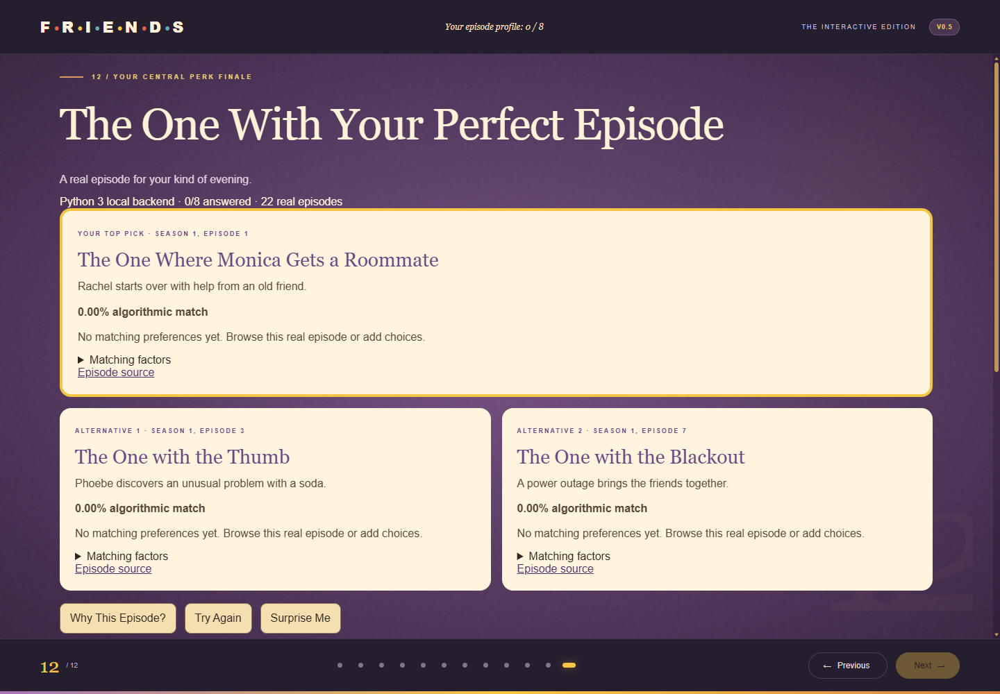
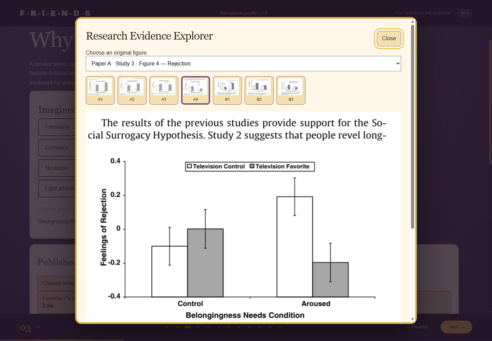

# FriendsAnxietyStudio — Version 0.5

A university Generative AI course demonstration about familiar fictional worlds, social surrogacy, and personal viewing preferences. Exactly **12 primary slides** lead to **The One With Your Perfect Episode**. It is an educational entertainment experience, not an anxiety treatment.

## Run locally

Requirements: Node.js 18+ (tests use Node.js 22+ with native WebSocket), Python 3.8+, and a modern WebGL browser. No packages, paid services, API keys, or runtime internet connection are required.

```powershell
node serve.cjs
```

Open http://127.0.0.1:8000. The server binds only to loopback. On Windows it calls `py -3`; on other systems it calls `python3`. To choose a Python executable:

```powershell
$env:FRIENDS_PYTHON = 'C:\ProgramData\Anaconda3\python.exe'
node serve.cjs
```

If port 8000 is occupied, set `$env:PORT = '8005'` before starting and open http://127.0.0.1:8005. Stop with Ctrl+C. Double-clicking `index.html` still supports slides and JavaScript recommendations, but genuine Three.js and Python require the local server.

## Version 0.5 features

- All 12 original slide positions, navigation, keyboard controls, deep links, responsive themes, quizzes, and settings retained. The final title now introduces the recommender.
- Original five-second Three.js mug with replay and manual controls; original interactive PIVOT couch with drag, keyboard, slider, angle feedback and reset.
- Eight optional preferences collected across slides, synchronized with an editable final profile and retained in sessionStorage within the tab. Clear one answer or reset all. Initial slider positions do not count as answers.
- 22 curated real episodes; one recommendation, two alternatives, actual matching factors, Try Again editor, and random Surprise Me discovery.
- Research Evidence Explorer: seven supplied original PNG figures, selector, thumbnails, accessible descriptions, citations, enlargement, native modal focus containment, Escape and focus restoration. Entry points on slides 3, 4, 6, 7, 8 and 12.
- Two animated interactive charts using published Study 1 descriptive means. The v0.4 synthetic chart remains separately labeled.
- Python comfort illustration with four sliders, animated visual feedback, character preference chart, mood indicator and comfort profile. The original v0.4 scenario simulation is retained separately.
- Both user-created artworks, preserved proportions and alt text, on the opening slide and relevant research, relationship, customization and final areas. Fade/hover animations respect system reduced motion; an additional setting disables decorative CSS motion.

## Technical architecture and actual Python execution

`script.js` owns the existing presentation and Three.js module mounts. `v05.js` progressively extends those same sections; it never creates extra primary slides. `v05.css` extends the established purple-door, yellow-frame, orange-couch visual language. Three.js r170 is bundled locally under MIT.

`serve.cjs` serves local assets and accepts JSON POST requests at `/api/recommend` and `/api/simulate`. A persistent **actual Python 3** worker runs `python/episode_recommender.py --worker`, accepting newline-delimited JSON on stdin and returning JSON on stdout. One interpreter serves all requests; rankings remain stateless and deterministic. Requests have a small body limit, local-origin checks and a request timeout. No profile is written by the server or sent to an external service. The presentation explicitly identifies the active execution mode.

Python analytics also run at build time: `python/research_analytics.py` exports the four documented means to `data/research_analytics.json`. `python/build_catalog.py` maintains the manually curated episode database and generates `data/v05-data.js`, which makes the catalog and means available even with direct file access.

When the API is absent, times out or Python is unavailable, a **labeled JavaScript fallback** uses the same scoring rules. It is not described as Python-powered. Surprise Me selects a different real episode using JavaScript randomness and computes its displayed match with the documented formula; it is labeled as random discovery. The simulator also identifies Python or JavaScript mode. Normal ranking is deterministic; Surprise Me intentionally is not.

## Recommendation algorithm

Ratings and tags are editorial, never research measurements. Episode metadata separates verifiable title/number/scene associations from subjective ratings. Featured characters are a curated emphasis list, not an exhaustive cast.

| Answer | Maximum points | Rule |
|---|---:|---|
| Mood | 18 | Exact editorial mood-tag match |
| Stress | 10 | With t = stress/10, blend `(t * warmth + (1-t) * comedy) / 5` |
| Character | 18 | Selected character in featured list |
| Quote | 18 | Exact documented episode quote association |
| Nostalgia | 10 | Closeness of 1–5 editorial rating to low=1, medium=3, high=5; credit `1 - distance/4` |
| Familiarity | 8 | New: standalone flag; rewatcher: nostalgia/5; some: 0.75 |
| Predictability | 8 | Exact editorial story-tag match |
| Desired experience | 10 | Laughter/light entertainment: comedy/5; warmth/friendship: warmth/5; nostalgia: nostalgia/5 |

Only answered factors enter the denominator. Match = 100 × earned / available points. No answers means 0% and chronological tie-breaking, not invented confidence. Points are rounded to four decimals before summing; final percentages to two. Ties sort by season and episode. Each explanation comes from the actual included factors; zero contributions remain visible in the breakdown.

The extra comfort index uses an explicitly invented formula: `50 - 3*stress + 2*(familiarity+nostalgia)*(1-exp(-minutes/20))`, bounded at 100. It is not fitted to either paper. All sliders use arbitrary values and do not forecast physiological outcomes.

## Data provenance and research references

1. Derrick, J. L., Gabriel, S., & Hugenberg, K. (2009). Social surrogacy: How favored television programs provide the experience of belonging. *Journal of Experimental Social Psychology, 45*, 352–362. https://doi.org/10.1016/j.jesp.2008.12.003. [Author lab PDF](https://ubwp.buffalo.edu/gabriellab/wp-content/uploads/sites/65/2025/04/Derrick-J.-L.-Gabriel-S.-Hugenberg-K.-J.-2009.-Social-surrogacy-How-favored-television-programs-provide-the-experience-of-belonging.pdf).
2. Derrick, J. L. (2013). Energized by Television: Familiar Fictional Worlds Restore Self-Control. *Social Psychological and Personality Science, 4*(3), 299–307. https://doi.org/10.1177/1948550612454889. First published online in 2012.

The analytics transcribe Paper A Study 1, Table 1, p. 355: favorite TV 5.81/2.64; whatever TV 4.86/3.69; favorite music 5.82/2.97; favorite movie 5.00/3.43. Both columns are 1–7 ratings; the loneliness column is reverse-scored so lower means less likely to feel lonely. These are undergraduate self-reports, not clinical anxiety scores or causal estimates. No new participant statistics or exact bar-height estimates are generated.

Paper A supplied Figures 1–4 represent Study 2 (essay time) and Study 3 (self-esteem, negative mood, rejection). The explorer distinguishes significant interactions from the marginal rejection interaction. Paper B Figures 1–2 are Study 1 experimental outcomes; Figure 3 is Study 2 diary evidence. Original supplied PNGs remain byte-for-byte unchanged. Source figures contain publisher typography/cropped page headers as supplied.

The two papers support discussion of social surrogacy and familiar fictional worlds. Predictability and low cognitive effort are broader explanatory interpretations; nostalgia is not directly tested by these two papers. Friends examples are illustrative. No claim is made that Friends treats anxiety, reduces cortisol, or produces a validated health benefit. Non-significance does not establish equivalence; diary associations do not prove causality.

Episode titles, season/episode numbers and plot associations were checked on 2026-11-01 against [TV Guide's season listings](https://www.tvguide.com/tvshows/friends/episodes-season-1/1030937287/) for seasons 1–6; every catalog record includes its specific season source URL. Quote associations are deliberately sparse: PIVOT! S5E16, Joey's greeting S4E13, Smelly Cat performance/recording S2E6/S2E17. There are no video or theme-music embeds.

Regenerate all v0.5 data:

```powershell
py -3 python/build_catalog.py
```

Regenerate only research JSON: `py -3 python/research_analytics.py`. Regenerate retained v0.4 synthetic data: `py -3 python/generate_data.py`. On other systems substitute `python3` for `py -3`.

## Artwork attribution

`assets/central-perk-original.png` and `assets/friends-couch-original.png` are **original user-created artwork**, supplied with the existing project. They are used directly, with `object-fit: contain`; no replacements, image generation or modifications were made. Original vector portraits, Three.js models and textures from v0.4 are retained. The seven research figures are supplied reproductions from their respective papers, credited to those authors/publishers, not user artwork. This is an unofficial educational project.

## Testing and screenshots

With the server running:

```powershell
py -3 tests/test_v05.py
node tests/browser-test.cjs
```

For an alternate server port, set `$env:TEST_BASE = 'http://127.0.0.1:8005'`. The browser suite launches an isolated headless Microsoft Edge; set `BROWSER_PATH` for another local Chromium executable. It retains the v0.4 behavioral checks, updating only the required final slide title, and adds v0.5 coverage. Temporary captures go into ignored `test-results/`; selected reviewed captures are committed under `screenshots/`.



[Matching factor breakdown](screenshots/match-breakdown.png) · [Mobile artwork and preserved mug](screenshots/mobile-artwork-and-mug.png)

Executed 2026-11-01: Python tests **7 passed**. The final expanded browser suite **263 checks passed**, with zero unexpected JavaScript errors and zero external network requests. An earlier retained regression run passed 227 checks. Tests include live Python API execution, fallback parity, profile persistence, figures/artwork, recommendations, controls, original Three.js, five viewport widths and reduced motion. Intentional WebGL removal emits two expected Three.js context errors. Both artwork Git hashes match v0.4; all seven research PNGs match the supplied ZIP byte-for-byte. All three data-generation commands executed successfully. Node syntax checks passed for v05.js and serve.cjs. Python/JavaScript parity was checked for empty, quote-only and fully populated profiles.

## Development history and AI-assisted development

- Initial presentation: existing commit `738469b`.
- v0.4: existing commit `feaf0e6`; preserved history and code for navigation, synthetic activities, mug timeline and couch.
- v0.5: research explorer, published-means analytics, Python APIs, progressive profile and deterministic recommender added within the existing project. One new local commit; no push.

OpenAI Codex was used as an AI development assistant to inspect the repository, draft Python/JavaScript/CSS, verify online references, design transparent editorial rules, write documentation and run tests. The recommender is ordinary deterministic code, not a live LLM or clinically trained model. No paid AI endpoint runs in the product. The user supplied the artwork and research PNGs; Codex did not generate replacement images.

Known limitations: the small catalog has 22 selected episodes, subjective comfort tags and a deliberately simple score. Content may feel different to different viewers. Initial Python worker startup may take several seconds; failures use explicit fallback labels. A tab stores optional preferences until reset or the session ends; private storage restrictions reduce reload persistence. The extra CSS motion toggle controls decorative motion; the operating system reduced-motion preference also governs Three.js. Long panels scroll within existing slides. No formal usability study, clinical validation or cross-browser certification has been performed.
