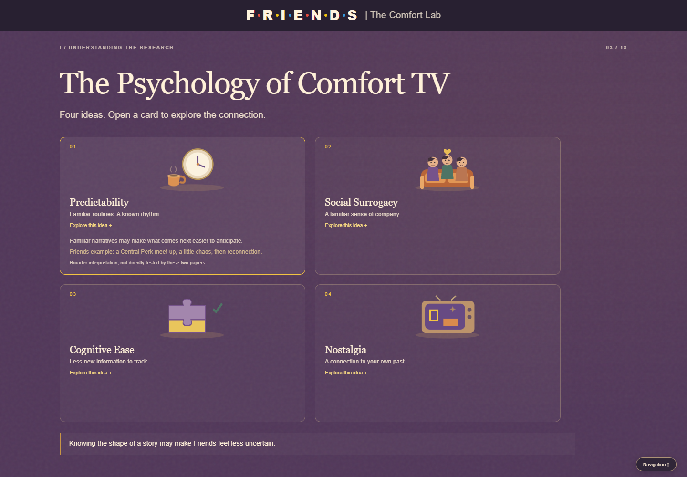
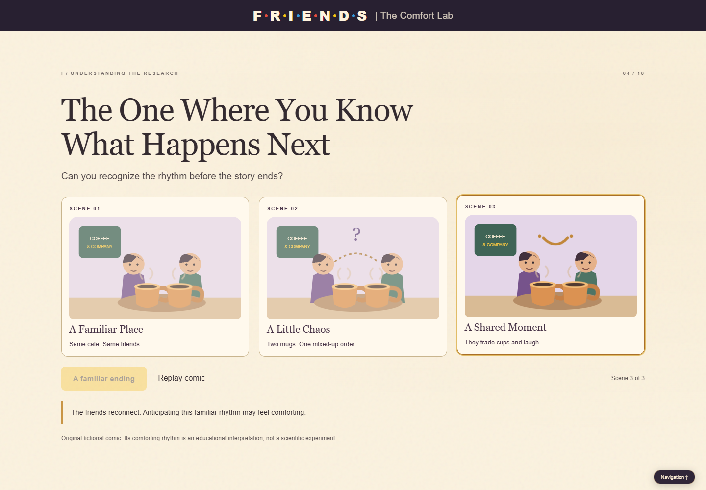
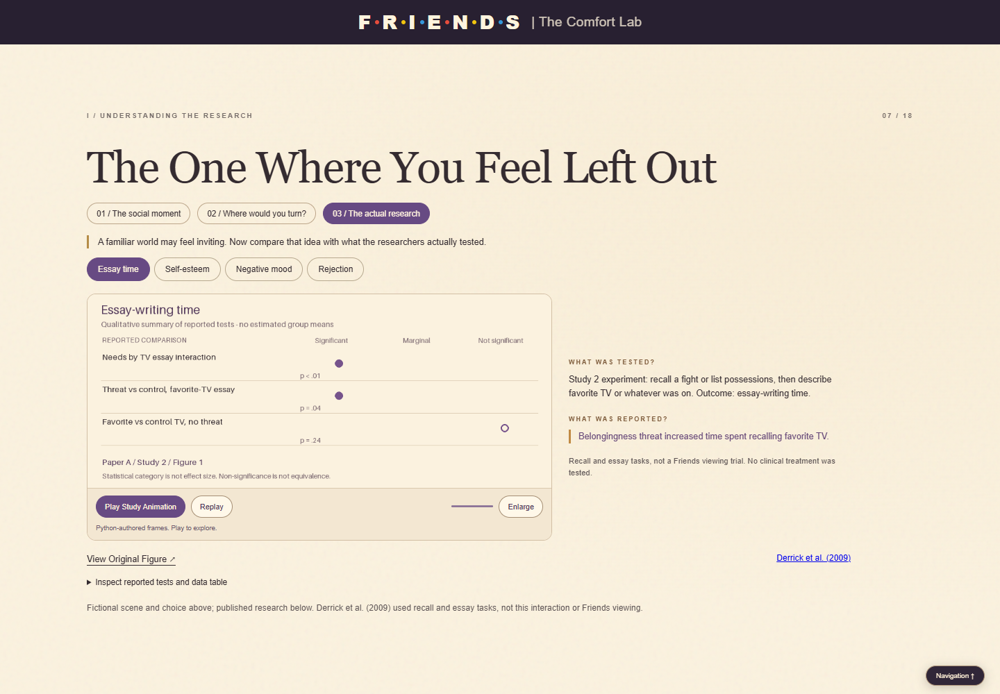
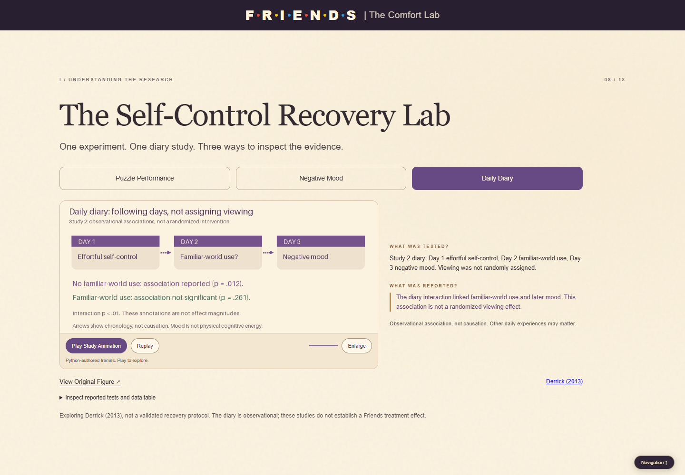
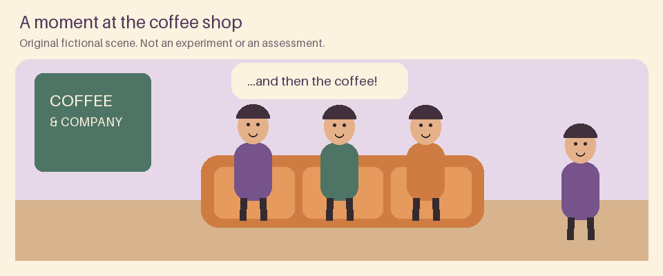
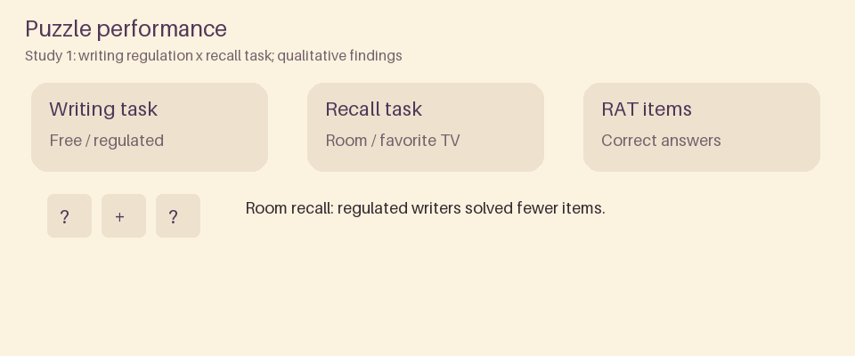

# Friends Comfort Lab - v1.0 FINAL

[Published presentation](https://liatkaf.github.io/friends-interactive-presentation/) - [Public repository](https://github.com/liatkaf/friends-interactive-presentation)

**Release status:** v1.0 is a local release candidate pending final review and publication approval. The public repository and Pages root returned HTTP 200 on November 6, 2026 ([read-only verification](llm_logs/v1-public-verification.json)). The published presentation is an earlier release, not evidence that v1.0 has been deployed. No push or release tag is part of this finalization.

An original, research-first HTML presentation exploring why familiar television can feel comforting, followed by an optional six-step profile and an explainable recommendation from **22 real Friends episodes**. It has **18 primary slides**: ten research/story slides, six questionnaire slides and two recommendation slides. This retains the user's approved scope; the lecturer's approximately ten-slide suggestion is flexible.

## Purpose and creative direction

Friends provides a recognizable cultural example through which to explain belonging, familiarity and comfort viewing. The user selected the topic and directed successive changes to the narrative, branding, research presentation, 3D game, questionnaire and reset behavior. These choices, rather than an invented personal biography, demonstrate personal involvement. Original code illustrations translate the user's coffee-shop, VHS, lobster and comic concepts into a coherent purple, yellow, cream and orange visual identity.

The featured papers did **not** test Friends as a clinical treatment. The presentation separates published evidence, broader psychological interpretations, fictional examples, editorial matching scores and educational simulations. It contains no episode footage or theme music.

## Start locally

Requirements: Node.js 18+ (22+ for browser QA), Python 3.8+, a modern browser; WebGL 2 is optional with fallbacks. No npm installation or API key is required.

```powershell
node serve.cjs
```

Open http://127.0.0.1:8000. On Windows the server invokes `py -3`; elsewhere `python3`. Set `FRIENDS_PYTHON` to a Python executable if necessary. The current review session uses http://127.0.0.1:8011.

For a clean static-host preview:

```powershell
python -m http.server 8013 --bind 127.0.0.1
```

Open http://127.0.0.1:8013. Serve over HTTP; direct file opening is not the supported way to load Three.js modules.

## What is new in v1.0

- **Slide 3:** four original SVG illustrated concept cards. Native buttons reveal explanations, a Friends example and the evidence level, updating a shared takeaway. Idle and interaction animations respect reduced motion.
- **Slide 4:** an original three-scene coffee-shop comic: a familiar place, mixed-up orders, then a shared moment. Step, select and replay controls connect predictable structure to an explicitly interpretive comfort takeaway.
- **Slide 7:** a gentle three-stage story: Python-animated fictional social moment, a familiar/new viewing choice, then actual research. The choice changes the narrative response without entering the profile or becoming experimental data. Four Python-authored research sequences retain the original figures and reported-test audit tables.
- **Slide 8:** three selectable lab modules: Puzzle Performance, Negative Mood and Daily Diary, with distinct Python-authored animations, design explanations, reported findings, limits, playback, replay and enlargement.

Preserved: continuous genuine Three.js mug with drag and inactive-slide pause; centered branding and idle-hidden navigation; 3D PIVOT stairwell and isolated game scoring; Study 1 chart; VHS rewind; lobster transition; six character and six quote choices; familiarity/nostalgia mapping; deterministic matching and alternatives; theme controls; keyboard navigation; responsive layouts; all seven original figures.

**Try Again clears the entire profile, persisted attempt, cached results and pending recommendation state, then returns to Slide 11. Back to Start and ordinary navigation preserve answers.** Enter advances only from noninteractive slide/background focus; native controls and dialogs keep normal keyboard behavior. Use the bottom Navigation button on touch devices or Tab to reach the dock.

## Architecture: what actually runs

| Layer | Responsibility |
|---|---|
| HTML/CSS | Accessible presentation shell, visual identity, responsive cards, original scene composition |
| `script.js`, `v06.js` | Slide templates/navigation, existing single profile state, recommendations and research dialogs |
| `v10-art.js`, `v10.js`, `v10.css` | Original SVG cards/comic, branching story, finite Python-frame playback and lab UI |
| `v08.js`, `v09.js` | Research chart, qualitative evidence access, navigation dock, rewind and lobster interactions |
| `mug.js`, `couch.js`, bundled Three.js r170 | Genuine 3D coffee and stairwell; no remote CDN dependency |
| `python/research_analytics.py` | Validate documented means and seven figure records; export research JSON |
| `python/generate_animations.py` | Render every animation pixel with Pillow; export posters, sprite atlases and GIF previews |
| `python/episode_recommender.py` | Actual persistent local Python worker, deterministic scoring through `/api/recommend` |
| `lab-core.js` | Equivalent JavaScript scoring fallback for static hosting or Python failure |

On GitHub Pages there is **no live Python runtime**. Python-generated data/assets still work, with JavaScript controlling frame playback and fallback matching. Locally the included server actually executes Python for matching. Engine diagnostics stay in the console and `FriendsLab.diagnostics`, outside ordinary user status text. No user profile is stored server-side or sent to an external AI service.

### Reproduce the Python animation pipeline

**Verified evidence - validated JSON - Python/Pillow frames - exported assets - JavaScript playback.**

```powershell
py -3 -m venv .venv
.venv/Scripts/python.exe -m pip install -r python/requirements-animation.txt
.venv/Scripts/python.exe python/research_analytics.py
.venv/Scripts/python.exe python/build_catalog.py
.venv/Scripts/python.exe python/generate_animations.py
```

On macOS/Linux use `python3` and `.venv/bin/python`. Pillow 10.4.0 is pinned; the generator uses its bundled default scalable font. A clean virtual environment avoids the broken system Pillow DLL encountered during this build. Dependency download needs internet, but regeneration and presentation playback do not. pandas/Matplotlib are unnecessary for categorical evidence and original frame artwork; Pillow is the actual authoring library.

Inputs: `data/research_source.json` (citations, verified means, study designs and categorical findings). Outputs: `data/research_analytics.json`, `data/v05-data.js`, `data/python_animations.json`, `data/python_animations.js`, and `assets/generated/`. The animation manifest records source/code/asset SHA-256 hashes. Eight sequences each have 16 frames, a 960x400 poster, a PNG frame atlas and a finite GIF preview: **24 image assets**, about 3.9 MB total. `--output <directory>` supports isolated generation. JavaScript does not redraw or invent the Python scenes; it displays the exported frames.

Historical `python/generate_data.py` produces explicitly synthetic educational illustrations, not published research measurements and not the data source for Slides 6-8. Do not confuse that retained artifact with the verified pipeline.

## Real screenshots and Python previews






Python-authored fictional scene (not a study or assessment):



Python-authored Study 1 puzzle evidence animation (qualitative tests, not measured effect sizes):



[All-slide contact sheets and visual review](screenshots/v10/visual-review.md) include desktop/mobile evidence, the preserved 3D game, reset and enlarged source/player views.

## The 18-slide scope

| # | Slide | Main educational or interactive role |
|---|---|---|
| 1 | Welcome to the Friends Comfort Lab | Original 3D opening and framing |
| 2 | Why Do We Rewatch Friends? | Introduce Study 1 descriptive comparisons |
| 3 | The Psychology of Comfort TV | Four interactive illustrated concepts |
| 4 | The One Where You Know What Happens Next | Original narrative comic |
| 5 | PIVOT! Concentration & Spatial Focus | Optional playful spatial interaction, no assessment |
| 6 | What the Research Shows | Detailed switchable Study 1 chart and data table |
| 7 | The One Where You Feel Left Out | Fictional social story followed by actual evidence |
| 8 | The Self-Control Recovery Lab | Three selectable Python research modules |
| 9 | The One With The Rewind | Broader nostalgia/ease interpretation |
| 10 | Finding Your Episode Lobster! | Explain entertainment matching, start questionnaire |
| 11 | How Are You Feeling? | Optional mood |
| 12 | What's Your Stress Level? | Optional 0-10 self-report, no diagnostic scale |
| 13 | Who's Your Favorite Friend? | Six character choices |
| 14 | Which Quote Speaks to You? | Six integrated quote choices |
| 15 | What Kind of Comfort Do You Need? | Desired viewing experience |
| 16 | How Familiar Is Friends to You? | Familiarity and nostalgia, one profile step |
| 17 | Finding Your Perfect Match | Actual computation state and reveal |
| 18 | The One With Your Perfect Episode | Main match, two alternatives, explanations, restart/reset |

Slides 2 and 6 intentionally preview then explain the same descriptive data. Slides 7 and 8 differ in interaction and research design. All 18 were retained and reviewed for purpose; none were merged without approval.

## Recommendation and data provenance

The catalog contains 22 real episodes. Titles, season/episode numbers and moment associations retain the prior release's documented verification. Mood/warmth/comedy/nostalgia/predictability tags are **editorial**, not measured psychological properties. Six quotes use `data/quotes.json` in both engines. Weights: mood 18, self-reported stress 10, character 18, quote 18, nostalgia 10, familiarity 8, predictability 8, experience 10. Only answered factors contribute to the available denominator; ties resolve by season/episode. The result includes actual contributing factors and two alternatives. Missing answers are allowed; match percentages are algorithmic, not scientific probabilities or prescriptions.

## Research references and boundaries

1. Derrick, J. L., Gabriel, S., & Hugenberg, K. (2009). Social surrogacy: How favored television programs provide the experience of belonging. *Journal of Experimental Social Psychology, 45*, 352-362. https://doi.org/10.1016/j.jesp.2008.12.003
2. Derrick, J. L. (2013). Energized by Television: Familiar Fictional Worlds Restore Self-Control. *Social Psychological and Personality Science, 4*(3), 299-307. https://doi.org/10.1177/1948550612454889 (first online 2012).

[Research integrity audit](docs/RESEARCH_INTEGRITY_AUDIT.md) identifies sources, design, claims and limits. Study 1 uses published 1-7 descriptive means, not clinical anxiety scores. Other animations summarize verified significant, marginal or nonsignificant tests without estimating group means from scans. Non-significance does not establish equivalence, p-values are not effect magnitudes, diary associations are not causal effects, and no physical cognitive-energy units were measured. The papers do not prove Friends treats anxiety or lowers cortisol. Predictability, cognitive ease and nostalgia examples are broader interpretations. All seven original PNG figures remain unchanged and accessible through View Original Figure.

The two user-created original artworks remain in `assets/` with attribution to the user but are deliberately absent from the UI following the user's design feedback. New illustrations are original code/Python artwork, AI-assisted under user direction, not copied television screenshots. Research figure copyright remains with the respective authors/publishers; scholarly attribution is not a license for unrestricted redistribution.

## Development, QA and academic evidence

[Release file manifest](docs/V1_RELEASE_MANIFEST.md) lists created/modified files. [Development journey](DEVELOPMENT_JOURNEY.md) links authentic Git milestones. [Prompt history](llm_logs/README.md) distinguishes recorded summaries from transcripts. Codex assisted implementation, research checks, testing and documentation; the user supplied creative direction and successive corrective specifications. No live LLM or paid service is required by the product.

[Final compliance matrix](FINAL_COMPLIANCE_REPORT.md) separates repository evidence from external Moodle actions. [Adversarial review](RED_TEAM_REVIEW.md) records findings, fixes, retests and the limits of a same-session AI review.

```powershell
.venv/Scripts/python.exe -m unittest discover -s tests -p 'test_*.py' -v
node tests/pivot-state-test.cjs
$env:TEST_BASE='http://127.0.0.1:8000'
node tests/browser-test.cjs
node tests/v10-ux-test.cjs
node tests/v10-layout-test.cjs
node tests/chart-layout-test.cjs
node tests/stairwell-context-test.cjs
node tests/capture-v10.cjs
```

Run browser suites sequentially to avoid competing software-WebGL processes. For `tests/v10-static-test.cjs`, set TEST_BASE to the clean static HTTP server. Browser QA uses installed Edge, Node's built-in CDP/WebSocket support and software WebGL; no Playwright dependency. Actual final results and screenshots are recorded in `screenshots/v10/visual-review.md` and its JSON reports. Python pixel/hash tests regenerate all exports in a temporary directory and compare bytes. Legacy test files and prior release screenshots remain historical evidence, not automatically claimed current passes.

## Accessibility, deployment and limitations

Native buttons, semantic figures/dialogs, focus indicators, keyboard playback, source tables and text captions complement visuals. System reduced motion or the quiet-motion setting uses static Python posters, avoids forced animation and preserves all explanations. Large text/small viewports may scroll within slides. Fine source scans and in-frame text can be enlarged; adjacent HTML explanations remain available.

Publish only after explicit user approval, using the repository's existing GitHub Pages configuration; then verify the deployed v1.0 assets, all 18 slides and fallbacks. Do not infer deployment from a local commit. No repository permission changes, release tag or Moodle submission were performed.

No physical-device or formal screen-reader testing, external human research review, clinical validation or new replication study is claimed. The older studies inform the educational narrative with the limits stated above. The optional game score and editorial episode match are independent of scientific assessment. See the compliance report for outstanding external actions.
