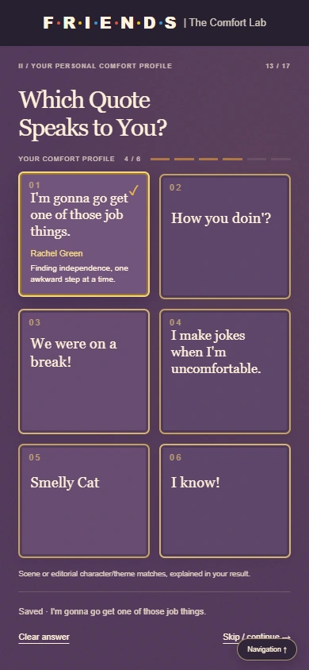
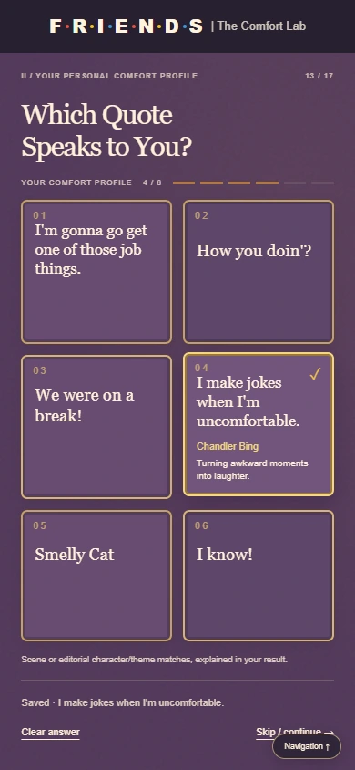

# Slide 13: final quote update

The approved update replaces the first and fourth cards on Slide 13. The 17-slide presentation, other questionnaire answers, PIVOT game, historical prompt records, and pre-profile fixture remain intact.

| Position | Character | Final line | Description |
|---|---|---|---|
| 1 | Rachel Green | I'm gonna go get one of those job things. | Finding independence, one awkward step at a time. |
| 2 | Joey Tribbiani | How you doin'? | Playful confidence and charm |
| 3 | Ross Geller | We were on a break! | Defensive passion and iconic debate |
| 4 | Chandler Bing | I make jokes when I'm uncomfortable. | Turning awkward moments into laughter. |
| 5 | Phoebe Buffay | Smelly Cat | Quirky individuality and humor |
| 6 | Monica Geller | I know! | High energy and perfectionism |

## Recommendation mapping

Rachel and Chandler use explicitly editorial quote-theme matches. Rachel's preferred affinity is the existing S1 E1 episode about starting over; Chandler's is the existing S4 E8 episode about making amends. These are curator-selected thematic affinities, not claims that either line occurs in those episodes. The quote factor keeps its existing 18-point maximum: 18 for the preferred affinity, 9 for another episode featuring the character, and 0 otherwise. The Python and JavaScript recommenders use matching rules and explanations. Other quote mappings, weights, and episode data are unchanged. Humor-as-coping is an educational interpretation, not a clinical claim or new research finding.

The wording is the exact user-requested excerpt. The [publisher's Friends quotation guide](https://www.hachette.com.au/oh/the-one-about-their-best-one-liners-the-little-guide-to-friends) supports Rachel's wording and independence context, and the longer Chandler line from which the requested excerpt is drawn.

## Screenshot evidence

The README's primary Slide 13 screenshot shows all six cards at once. Additional captures show the two longer quotes selected at mobile widths:

The primary screenshot replaced only `screenshots/readme-tour/slide-13.webp`; the other 16 guided-tour screenshot hashes are unchanged. The capture inventory records the updated source and hash.

## Verification

- Targeted browser checks: **65 passed**, zero errors. Coverage includes the six exact quote/name/description pairs, one card per character, selection and reveal animation, keyboard activation, navigation and reload persistence, clear/skip/reset, JavaScript/Python scoring parity, recommendation outcomes, and all 17-slide navigation.
- Responsive layouts: **15 of 15 passed**, including Rachel, Chandler, and Monica selected at desktop, tablet, 390px, and 320px widths.
- Final recapture after tightening the source note: **5 of 5 fit checks passed**; desktop and both mobile screenshots were regenerated from the final working copy.
- Presentation regression: **433 checks passed**; Python discovery: **30 tests passed**; PIVOT rules: **33 passed**. These existing successful suites were not rerun during the final publication pass.
- `git diff --check` passed. No presentation functionality changed beyond the authorized quote text/mapping and scoped mobile text fit.

Live deployment and public README image verification are recorded after publication.
